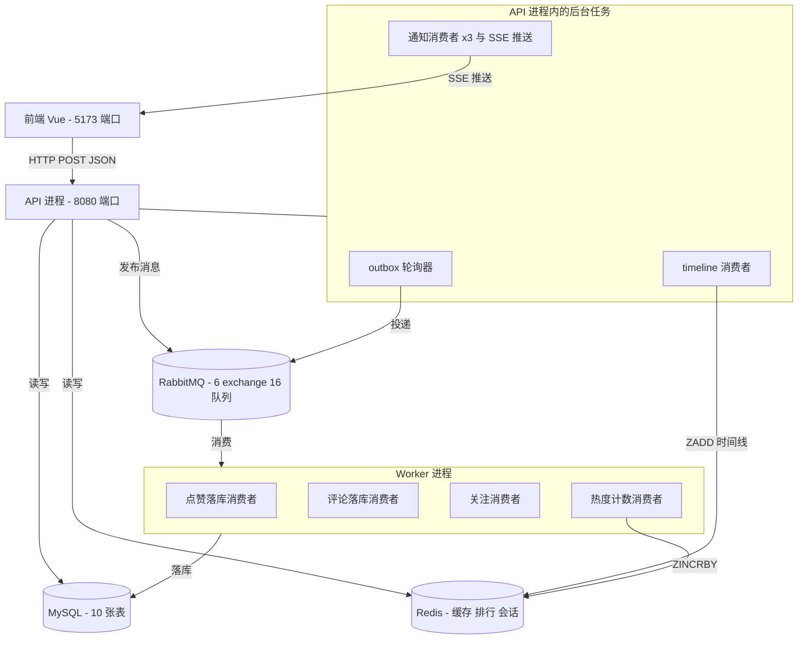
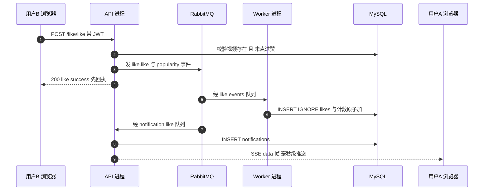
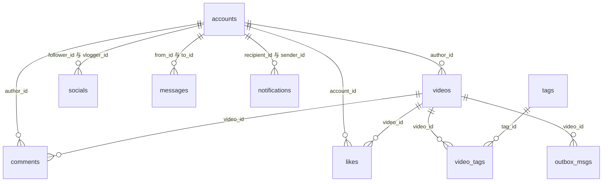
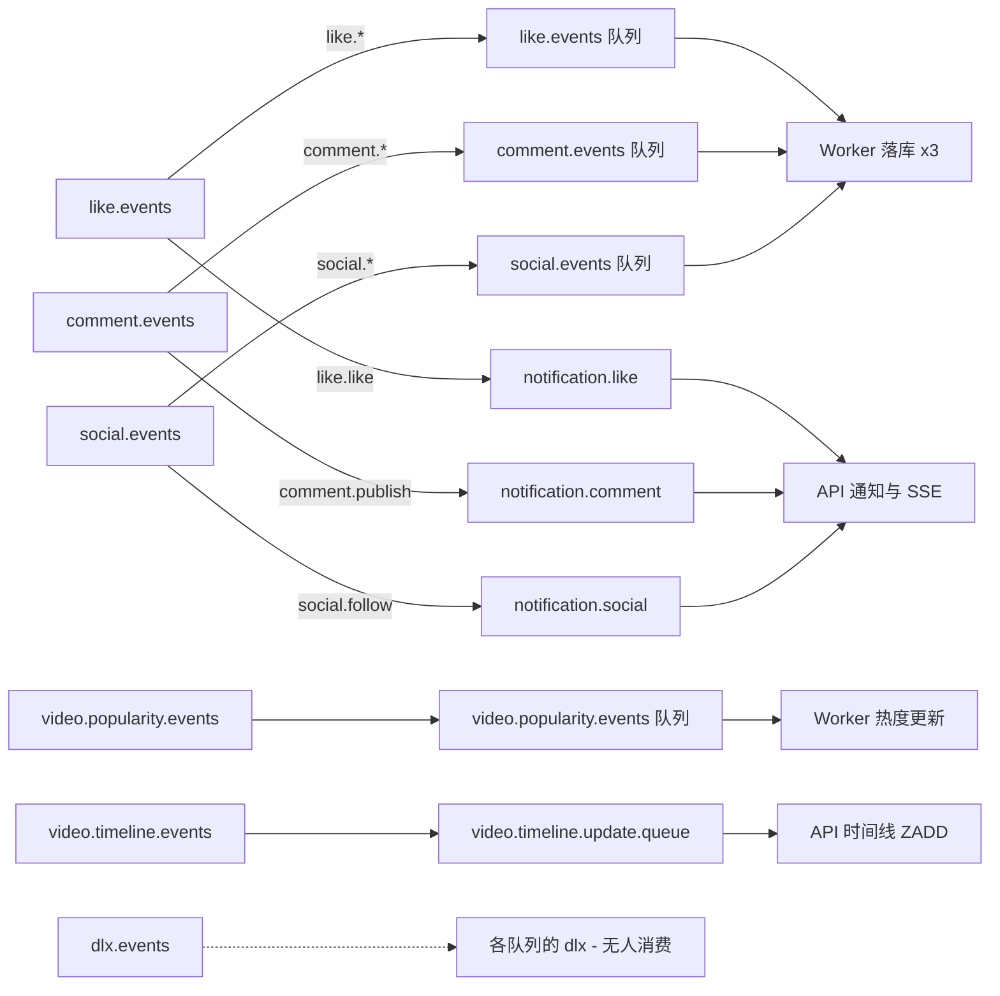

> **定位**：选修资料。原版 Go 系统全景（RabbitMQ 口径，仅作行为规格出处与差异测试参考）。
> 主线实现不需要读本册；你的 Kafka 版消息设计以《07》为准。

# 阶段 0 · 项目全景与源码导览

> **目标**：不写代码，先搞清楚你要重写的系统长什么样，并把 Go 版跑起来。
> **预计用时**：半天。
> **完成标准**：能画出系统结构图，说清一条点赞请求的完整走向，Go 版全部功能可用。

## 1. 这是一个什么项目

一个简化版的抖音后端：用户上传短视频，其他用户刷视频、点赞、评论、互相关注，
系统给出推荐流和热榜，并有实时通知和私信。

| 组成 | 技术 | 位置 |
|------|------|------|
| 后端 API | Go + Gin + GORM | `feedsystem_video_go-main/backend/` |
| 异步 Worker | 同一份 Go 代码，另一个入口 | `backend/cmd/worker/` |
| 前端 | Vue 3 + TypeScript | `feedsystem_video_go-main/frontend/` |
| 数据库 | MySQL 8.0 | 经 Docker 启动 |
| 缓存 | Redis 7 | 经 Docker 启动 |
| 消息队列 | RabbitMQ 3 | 经 Docker 启动 |

后端 Go 源码约 7700 行、43 个业务接口（另有 1 个 `/healthz`，按 router 与 ssehub

注册代码逐条数得）。业务功能按模块分组如下：

| 模块 | 功能 | 涉及的技术点 |
|------|------|--------------|
| 账号 | 注册、登录、令牌刷新、改名、改密、头像 | 密码哈希、JWT、token 白名单 |
| 视频 | 整段上传、分块上传（断点续传）、发布、详情 | multipart、MD5、缓存 |
| 评论 | 发表、删除、列表、@提及 | 正则解析、通知 |
| 点赞 | 点赞、取消、状态查询、我赞过的 | 唯一索引、异步落库 |
| 关注 | 关注、取关、列表、计数 | 状态机、缓存失效 |
| Feed 流 | 推荐流、关注流、点赞榜、热榜、话题流 | 游标分页、Redis ZSET |
| 通知 | 点赞/评论/关注/提及通知、SSE 实时推送、未读数 | 长连接、消息扇出 |
| 私信 | 发送、按对方查看最近 50 条 | 基础 CRUD |
| 工程 | 限流、健康检查、性能剖析、Docker 部署 | 中间件、可观测性 |

## 2. 系统由两个进程组成

这是理解整个项目最重要的一个事实：**后端是两个进程，共用同一套代码**。



两个容易看漏的点（都已在源码中核实）：

1. **API 进程不只处理 HTTP**。它还运行三类后台任务：视频 outbox 投递、
   全局时间线消费、通知消费与 SSE 推送。原因：SSE 连接保存在 API 进程的内存里，
   通知必须由本进程消费才能即时推送。
   （出处：`backend/internal/http/router.go` 末尾约 60 行。）
2. **Redis 和 RabbitMQ 都是可选依赖**。启动时连接失败不会阻止进程运行，
   相关功能自动降级：缓存跳过、点赞退回同步写库。这是本项目的亮点设计，
   Java 版要原样保留。

一次"用户 B 点赞用户 A 的视频"的完整旅程（把上面两张图串起来）：



## 3. 数据都存在哪里

### 3.1 MySQL：10 张表

表名是 GORM 默认的"复数、下划线"规则，代码中没有手工改名。

| 表 | 用途 | 关键字段 |
|----|------|----------|
| `accounts` | 用户 | `username` 唯一；`token`、`refresh_token` 存当前有效凭证 |
| `videos` | 视频元数据 | `likes_count`、`popularity` 两个计数列 |
| `comments` | 评论 | 冗余存 `username` |
| `likes` | 点赞关系 | `(video_id, account_id)` 联合唯一索引 |
| `socials` | 关注关系 | `(follower_id, vlogger_id)` 联合唯一索引 |
| `tags` / `video_tags` | 话题及关联 | 多对多 |
| `outbox_msgs` | 视频发布的本地消息表 | `status` 列实际只有 `pending` 一个值 |
| `messages` | 私信 | `is_read` 列无接口维护 |
| `notifications` | 站内通知 | `recipient_id`、`type`、`is_read` |

> 说明：`likes` 表是事实来源，`videos.likes_count` 是为读加速维护的计数列，
> 两者最终一致而非强一致。`popularity` 热度列由点赞和评论共同 ±1 驱动。

表关系速览（连线标注的是外键字段）：



原仓库 `picture/` 下有 12 张图，全部值得翻一遍：表关系、用户表、视频表、评论表、点赞表、关注表、整体架构、整体流程，以及登录鉴权与 token 撤销、点赞评论异步落库与热度降级、Feed 返回结构、Feed 软鉴权与缓存热榜分页游标各一张。文件名以该目录实际内容为准（本节写作时共 12 个文件）。

### 3.2 Redis：四组用途

业务缓存 key 由统一的封装函数生成，默认带前缀 `v1:`（`backend/internal/middleware/redis/redis.go`）。探针、限流等系统 key 是显式例外，具体以各阶段文档和实现为准。

| 组 | key 形状 | 用途 |
|----|----------|------|
| 令牌 | `v1:account:{id}`、`v1:account:{id}:refresh`、`v1:refresh:{token}` | 当前有效 token 白名单与刷新 |
| 视频缓存 | `v1:video:detail:id={id}`、`v1:video:entity:{id}` | 详情缓存、Feed 批量读 |
| 流与热榜 | `v1:feed:global_timeline`、`v1:feed:listByFollowing:...`、`v1:hot:video:1m:{分钟}`、`v1:hot:video:merge:1m:{分钟}` | 推荐窗口、关注流整页缓存、热度滑动窗口 |
| 功能件 | `v1:chunk_upload:{id}`、`v1:chunk_upload_hash:{uid}:{hash}`、`lock:v1:{key}`、`feedsystem:ratelimit:{规则}:{对象}` | 上传会话、分布式锁、限流计数 |

精确的 TTL、类型、读写方在后续阶段文档和《08》的缓存地图中给出。

### 3.3 RabbitMQ：一张总表

5 个业务 exchange，每个都配"业务消费者 + DLX 声明"；通知另挂 3 个队列。
下表全部经源码核对，Java 版照抄这些名字。

| Exchange（type=topic，持久） | Routing Key | 队列 | 消费者所在进程 |
|-------------------------------|-------------|------|----------------|
| `like.events` | `like.like` / `like.unlike` | `like.events` | Worker：点赞落库 |
| | `like.like` | `notification.like` | API：通知 + SSE |
| `comment.events` | `comment.publish` / `comment.delete` | `comment.events` | Worker：评论落库 |
| | `comment.publish` | `notification.comment` | API：通知 + SSE |
| `social.events` | `social.follow` / `social.unfollow` | `social.events` | Worker：关注落库 |
| | `social.follow` | `notification.social` | API：通知 + SSE |
| `video.popularity.events` | `video.popularity.update` | `video.popularity.events` | Worker：热度 ZINCRBY |
| `video.timeline.events` | `video.timeline.publish` | `video.timeline.update.queue` | API：时间线 ZADD |
| `dlx.events` | `#` | `{各队列}.dlx` | 无人消费（原版死信形同虚设；你版的死信设计见《07》第 2 步） |

消息流向一图总览（实线=现有链路；DLX 链路只声明不路由，见《07》）：



## 4. HTTP 接口的四条通用约定

全部 43 个接口的清单见原仓库 `README.md`；逐接口契约在阶段 3-8 的文档中。通用规则：

1. **请求**：除文件上传是 multipart、SSE 是 GET 外，全部是 `POST` + JSON body。
2. **响应没有统一包装**。成功时各接口返回自己的 JSON 结构；
   失败时统一为 `{"error": "文字"}` 加一个 HTTP 状态码。
3. **鉴权**：请求头 `Authorization: Bearer <token>`。令牌 15 分钟过期；
   服务端还维护"当前有效 token"白名单，同一账号重复登录会踢掉旧登录。
4. **路径**：前端经代理把 `/api` 前缀剥掉，后端真实路由没有 `/api`（如 `/account/login`）；
   上传文件通过 `/static/**` 访问。

## 5. 源码目录地图

```text
backend/
├── cmd/main.go            API 进程入口
├── cmd/worker/main.go     Worker 进程入口
├── configs/               三套 YAML 配置（本地 / compose / docker）
└── internal/
    ├── http/router.go     全部路由注册 + 限流挂载（找接口入口先看这里）
    ├── apierror/          错误 → HTTP 状态码的映射规则
    ├── config/  db/       配置加载；MySQL 连接与自动建表
    ├── auth/              JWT 与 refresh token 的生成、校验
    ├── middleware/
    │   ├── jwt/           鉴权中间件（强鉴权 / 软鉴权）
    │   ├── ratelimit/     固定窗口限流
    │   ├── redis/         Redis 封装：key 前缀 / 缓存 / 锁 / ZSET / Lua
    │   └── rabbitmq/      连接管理与 5 个业务的消息发布封装
    ├── account/ feed/ social/ message/    各自一套：entity / handler / repo / service
    ├── video/             最大的包：视频、评论、点赞、标签、分块上传、热度
    └── worker/            MQ 消费者 + SSEHub（注意：这个包跑在两个进程里）
```

每个业务包都是四件套，与 Java 分层一一对应：

| Go 文件 | 职责 | Java 对应 |
|---------|------|-----------|
| `entity.go` | 结构体定义 + 数据库列 + JSON 字段名 | Entity / DTO |
| `handler.go` | 解析请求、调 service、写响应 | Controller |
| `service.go` | 业务规则、编排缓存与消息 | Service |
| `repo.go` | 全部 SQL | Mapper / Repository |

## 6. 动手：把原版（Go）跑起来（选修——只有要做差分对照时才需要）

> 主线阶段不需要跑原版。真要跑，先看这一句：原版的 MySQL/Redis 端口与
> `feed-java/deploy/docker-compose.yml`（《02》第 2 步）**完全相同**，同一台机器上两份 compose
> **不能同时启动**；而且数据卷是分开的，各起各的就等于两套独立的库。
> 想让两版共用同一套数据，就只保留 Java 那份容器，原版只跑它的进程（见本节第 2、3 步）。

按顺序执行，每一步验证通过再做下一步。

1. 启动依赖服务——**二选一**。

   方案 A（推荐，共用 Java 的容器）：确认 `feed-java/deploy` 那份在跑，原版不再 `up`，
   但原版还需要一个 RabbitMQ（Java 版用 Kafka，那份 compose 里没有它）：
   ```bash
   cd feedsystem_video_go-main
   docker compose up -d rabbitmq        # MySQL/Redis 复用 Java 那边已有的 3307 / 6379
   ```
   方案 B（完全隔离，原版自己一套）：先把 Java 那份 `docker compose stop`，再
   ```bash
   cd feedsystem_video_go-main
   docker compose up -d mysql redis rabbitmq
   ```
   预期：`docker compose ps` 显示所启服务 healthy。三个服务的参数都定义在
   `feedsystem_video_go-main/docker-compose.yml`，要点抄录如下：

   | 服务 | 镜像 | 宿主机访问地址 | 账号 / 密码 |
   |------|------|----------------|-------------|
   | MySQL | `mysql:8.0` | **localhost:3307**（容器内仍是 3306） | root / 123456，库名 `feedsystem`，字符集 utf8mb4 |
   | Redis | `redis:7-alpine` | localhost:6379 | 密码 123456，开启持久化 |
   | RabbitMQ | `rabbitmq:3-management` | localhost:5672；管理台 <http://localhost:15672> | admin / password123 |

   逐个验证：
   ```bash
   docker exec -it $(docker compose ps -q mysql) \
     mysql -uroot -p123456 -e 'SHOW DATABASES;'          # 应含 feedsystem
   docker exec -it $(docker compose ps -q redis) \
     redis-cli -a 123456 ping                            # PONG
   docker exec -it $(docker compose ps -q rabbitmq) \
     rabbitmq-diagnostics -q ping                        # 无报错退出码 0
   ```

   > 说明：Java 版有**自己**的一份依赖清单，在 `feed-java/deploy/docker-compose.yml`
   > （MySQL + Redis + 阶段 7 追加的 Kafka），不依赖本仓库这份。两份的端口相同，只能二选一运行。
2. 启动 API 进程（新开一个终端）。
   ```bash
   cd feedsystem_video_go-main/backend
   go mod download        # 首次拉取 Go 依赖，约 1-2 分钟；之后可跳过
   CONFIG_PATH=configs/config.compose-local.yaml go run ./cmd
   ```
   预期：日志出现 `Redis connected`、`Server is running on port 8080`。
   验证：`curl -s --noproxy '*' localhost:8080/healthz` 返回 `{"status":"ok"}`。
3. 启动 Worker 进程（再开一个终端）。
   ```bash
   cd feedsystem_video_go-main/backend
   CONFIG_PATH=configs/config.compose-local.yaml go run ./cmd/worker
   ```
   预期：日志出现四条 `xxxWorker started, consuming`（四个 worker 各一条）。
4. 启动前端（再开一个终端；需 Node 20+，本机 v26 已满足）。
   ```bash
   cd feedsystem_video_go-main/frontend
   npm install && npm run dev
   ```
   预期：浏览器打开 <http://localhost:5173>。
5. 玩一遍完整流程：注册两个账号（A、B）→ A 上传并发布视频 →
   B 登录，刷到视频，点赞、评论 `@A`、关注 A → A 打开另一浏览器看到通知红点 → 收到私信。
   点赞那一步的逐帧链路，对照第 2 节末尾的时序图核验。
6. 打开 RabbitMQ 管理台 <http://localhost:15672>（admin / password123），
   找到 `like.events` 队列，点赞一次，观察 Messages 计数的瞬时波动和 consumer 数量。

7. 记录两个日常操作：
   ```bash
   docker compose logs -f rabbitmq    # 跟踪某个服务日志
   docker compose down -v             # 彻底重置：删除数据卷，10 张表/缓存/队列定义全消失
   ```

> 警告：这一步是后续所有"对照测试"的基准。跑不通不要进入阶段 1，先解决环境问题。

## 7. 本阶段自检

以下问题都应能不查资料直接回答：

1. API 进程和 Worker 进程各自运行哪些后台任务？通知消费者为什么在 API 进程？
2. 用户点赞一次，数据一共落在几个地方？哪个是事实来源？
3. 新发布的视频要经过哪些环节才会出现在推荐流里？（提示：outbox → 队列 → ZSET）
4. Redis 停机后重启 Go 版，系统还能工作吗？哪些行为会变？
5. 前端请求 `/api/account/login`，到达后端时是什么路径？

## 8. 常见问题

**Q1：跟着原仓库的图，找不到 API 进程里的通知消费者。**
原因：`picture/整体架构.png` 没画这部分。
处理：以 `internal/http/router.go` 为准，架构图仅供参考。

**Q2：原 README 和设计文档里的描述与代码不一致。**
原因：文档漂移，实际存在多处（例如设计文档写"评论列表缓存"，代码中并无此缓存）。
处理：一切以源码为准；本指南中标注"已核对"的内容可直接信任。

**Q3：`internal/worker/` 这个包名有迷惑性。**
原因：里面的 SSEHub、通知消费者、timeline 消费者其实运行在 API 进程。
处理：把包名理解为"后台任务代码库"，进程归属看调用方。

**Q4：curl 本机接口全部返回空，但服务日志明明在监听。**
原因：终端会话带 `HTTP_PROXY/HTTPS_PROXY`（如 clash 的 7890），`localhost` 请求被代理转发后失败。
处理：给每条 curl 加 `--noproxy '*'`（或在脚本里 `export NO_PROXY=localhost,127.0.0.1`）。
本指南全部验收命令默认直连，请保留这个习惯；Playwright 浏览器不受影响。

**Q5：`docker compose up` 拉镜像超时（`registry-1.docker.io` i/o timeout）。**
原因：本机到 Docker Hub 的网络不通。
处理：从公共镜像拉取后重打标签，compose 即按本地镜像启动：
```bash
docker pull docker.1ms.run/library/mysql:8.0 && docker tag docker.1ms.run/library/mysql:8.0 mysql:8.0
```
不同镜像可能需要在 `docker.1ms.run`、`docker.m.daocloud.io` 等镜像间切换
（2026-09-03 实测：mysql/redis 走前者，rabbitmq 需换后者）。

**Q6：前端 `npm install` 报 `Fetching packages of type "remote" have been disabled`。**
原因：`package-lock.json` 的 `resolved` 指向 registry.npmmirror.com，与默认 registry（npmjs.org）
不同源，被新版 npm 的供应链策略拦截。
处理：`npm install --registry=https://registry.npmmirror.com`，让 registry 与 lockfile 同源。
