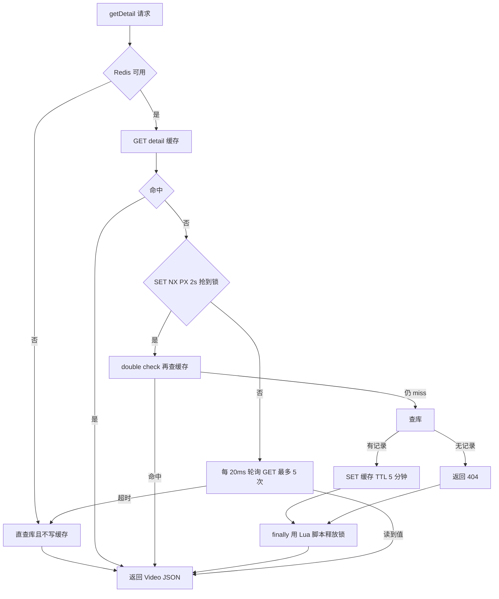
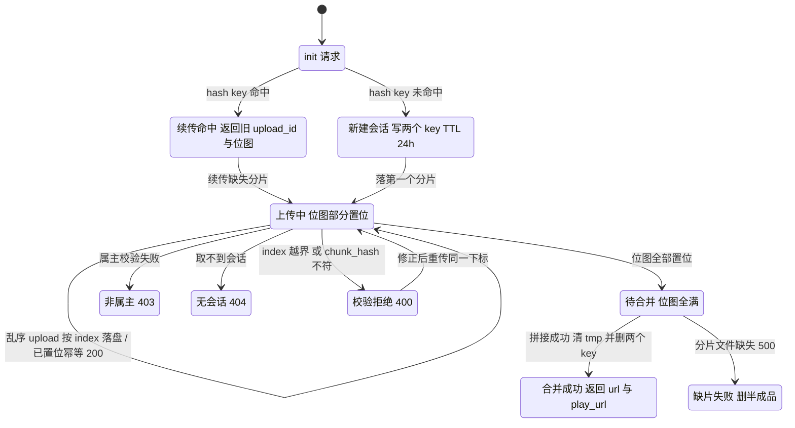

# 阶段 4 · 视频与分块上传

> **本阶段做什么**：建视频相关的四张表，做整段上传、发布（含话题抽取）、两个读接口，以及一个用 Redis 存状态的分块断点续传协议。
> **做完能演示**：整段视频上传并发布；分块上传中途 `kill -9` 后续传、合并出逐字节一致的文件。
> **开工前确认**：《03》验收清单全绿（除 `listByAuthorID` / `getDetail` 外，本阶段接口全部要登录，走《03》第 6 步那个 `JwtAuthInterceptor`）；
> 库里已有 `accounts`（《03》第 1 步），本阶段第 1 步再建四张；Redis 容器在跑（《02》第 2 步）；
> `data/uploads` 目录与 `/static/**` 映射已就位（《02》第 6 步）；可复用的类：`RedisKeys`、`FeatureFlags`、`TokenStore`。这是全项目最接近"传统后端工程"的一段：multipart 文件处理、磁盘目录规划、一个带分布式锁的缓存读路径。

## 第 1 步 · 建视频相关的四张表

建表这件事每个阶段开头做一次（原因见《03》第 1 步）。要看清建什么：`videos` 存视频本体，`tags` 与 `video_tags` 存话题及关联，`outbox_msgs` 是本地消息表（第 5 步写、阶段 7 才消费）。
进容器：`cd deploy && docker compose exec -it mysql mysql -uroot -p123456 feedsystem`，把下面整段粘进去执行（MySQL 8 语法）：

```sql
CREATE TABLE `videos` (
  `id` bigint unsigned NOT NULL AUTO_INCREMENT,
  `author_id` bigint unsigned NOT NULL,
  `username` varchar(255) NOT NULL,
  `title` varchar(255) NOT NULL,
  `description` varchar(255) DEFAULT NULL,
  `play_url` varchar(255) NOT NULL,
  `cover_url` varchar(255) NOT NULL,
  `create_time` datetime(3) DEFAULT NULL,
  `likes_count` bigint NOT NULL DEFAULT '0',
  `popularity` bigint NOT NULL DEFAULT '0',
  PRIMARY KEY (`id`),
  KEY `idx_videos_author_id` (`author_id`),
  KEY `idx_videos_create_time` (`create_time` DESC),
  KEY `idx_videos_popularity_time_id` (`popularity` DESC, `create_time` DESC),
  KEY `idx_videos_likes_count_id` (`likes_count` DESC)
) ENGINE=InnoDB DEFAULT CHARSET=utf8mb4 COLLATE=utf8mb4_0900_ai_ci;

CREATE TABLE `tags` (
  `id` bigint unsigned NOT NULL AUTO_INCREMENT,
  `name` varchar(100) NOT NULL,
  PRIMARY KEY (`id`),
  UNIQUE KEY `idx_tags_name` (`name`)
) ENGINE=InnoDB DEFAULT CHARSET=utf8mb4 COLLATE=utf8mb4_0900_ai_ci;

CREATE TABLE `video_tags` (
  `id` bigint unsigned NOT NULL AUTO_INCREMENT,
  `video_id` bigint unsigned NOT NULL,
  `tag_id` bigint unsigned NOT NULL,
  PRIMARY KEY (`id`),
  KEY `idx_video_tags_video_id` (`video_id`),
  KEY `idx_video_tags_tag_id` (`tag_id`)
) ENGINE=InnoDB DEFAULT CHARSET=utf8mb4 COLLATE=utf8mb4_0900_ai_ci;

CREATE TABLE `outbox_msgs` (
  `id` bigint unsigned NOT NULL AUTO_INCREMENT,
  `video_id` bigint unsigned DEFAULT NULL,
  `event_type` varchar(50) DEFAULT NULL,
  `create_time` datetime(3) DEFAULT NULL,
  `status` varchar(50) DEFAULT NULL,
  PRIMARY KEY (`id`),
  KEY `idx_outbox_msgs_video_id` (`video_id`),
  KEY `idx_outbox_msgs_status` (`status`)
) ENGINE=InnoDB DEFAULT CHARSET=utf8mb4 COLLATE=utf8mb4_0900_ai_ci;
```

验证：`SHOW TABLES;` 期望多出这四张；`SHOW CREATE TABLE videos\G` 期望看到 `idx_videos_popularity_time_id`。
两句解释：`create_time`/`created_at` 这类列用 `datetime(3)`（毫秒精度），Java 侧字段一律写 `OffsetDateTime`（**不要用 `LocalDateTime`**：JSON 里的时间是 RFC3339、带 `+08:00` 这类偏移，`LocalDateTime` 会把偏移丢掉，阶段 8 跨实例互读 Redis 缓存时必然对不上，见《08》的序列化契约）；`outbox_msgs.status` 只用 `'pending'` 一个值——阶段 7 的 OutboxPoller 发完就删行，不改成 done。
**通过标志**：四条 `CREATE TABLE` 都返回 `Query OK`，`SHOW TABLES;` 能看到 `videos`、`tags`、`video_tags`、`outbox_msgs`。

## 第 2 步 · 抄下接口契约

本节是实现依据。**字段名、错误文案、键格式、数值阈值都属于契约。** 鉴权与错误码沿用阶段 3 定稿的路线；参数校验失败的响应文案不必逐字，**状态码必须一致**。

| 路径 | 鉴权 | 请求 | 成功响应 | 失败响应 |
|---|---|---|---|---|
| `POST /video/uploadVideo` | 是 | multipart `file` | `{"url","play_url"}`（两字段同值绝对 URL） | 非 `.mp4` 或体积越界 400 |
| `POST /video/uploadCover` | 是 | multipart `file` | `{"url","cover_url"}`（同值） | 扩展名/体积不符 400 |
| `POST /video/publish` | 是 | `{title, description, play_url, cover_url}` | **整个 Video 实体** JSON（含 `id`，`create_time` 为 RFC3339） | 必填缺失 **500** + `title is required` / `play url is required` / `cover url is required` |
| `POST /video/listByAuthorID` | **否** | `{author_id}` | Video 数组，`create_time DESC LIMIT 200`，**空为 `[]`** | 查库失败按错误码路线返回 |
| `POST /video/getDetail` | **否** | `{id}` | Video 实体（缓存策略见第 6 步） | 查无 **404** |
| `POST /video/chunk/init` | 是 | `{filename, file_size, chunk_size, total_chunks, file_hash}` | 见第 8 步（新建或续传） | 校验不过 400；Redis 不可用 **503** `{"error":"chunk upload requires redis"}` |
| `POST /video/chunk/upload` | 是 | form `upload_id`、`chunk_index`、`chunk_hash` + `file` | `{"chunk_index": n}` | 404 / 403 / 400，见第 9 步 |
| `POST /video/chunk/status` | 是 | `{upload_id}` | `{upload_id, uploaded_chunks:[已传下标], total_chunks}` | 404 / 403 |
| `POST /video/chunk/complete` | 是 | `{upload_id}` | `{"url","play_url"}` | 400 / 500，见第 9 步 |

**通过标志**：能说出哪两个接口免登录（`listByAuthorID`、`getDetail`）、四个 chunk 端点在 Redis 不可用时统一返回什么状态码。

## 第 3 步 · 规划目录并写 FilesTool

先定磁盘布局（分块合并、断点续传、静态访问都靠它），根目录必须取配置的**绝对路径**，不受启动目录影响：

```text
uploads/
├── avatars/{userId}/{16字节hex}{ext}              ← 阶段 3
├── covers/{userId}/{yyyyMMdd}/{16字节hex}{ext}
├── videos/{userId}/{yyyyMMdd}/{16字节hex}.mp4
└── tmp/{uploadId}/{chunkIndex}                    ← 分块临时落盘，文件名就是数字下标
```

要写的文件（都在 `video` 包 = `src/main/java/io/github/p_feed/video/`）：`VideoController` / `VideoService` / `VideoMapper`（上传、发布、两个读接口）、`ChunkController` / `ChunkSessionStore`（分块状态机，无 DB，纯 Redis + 磁盘）、
`VideoCacheService`（第 6 步的锁读路径）、四张表对应的实体与 Mapper（`Video`、`Tag`、`VideoTag`、`OutboxMsg`）；
另建 `tool/FilesTool`（跨模块工具：03 头像、04 上传共用）。

写 `FilesTool`：URL 按 `{scheme}://{请求 Host 头}/{相对路径}` 拼，`scheme` 取 `X-Forwarded-Proto`，否则按是否 TLS；
文件靠《02》第 6 步那条 `/static/**` 映射对外访问，不要自己写下载 Controller。`FilesTool` 允许不注入（缺省则不启用上传）；阶段 3 的头像 URL 构造复用同一个类。
**通过标志**：单测断言同一个 `userId` 两次生成的路径前缀相同、文件名不同，且 URL 带正确 Host 头。

## 第 4 步 · 写 `uploadVideo` 与 `uploadCover`，并把 multipart 上限配足

规格：整段视频**仅 `.mp4`**，`0 < size ≤ 200 MB`，否则 400；封面 `.jpg` / `.jpeg` / `.png` / `.webp`，**≤ 10 MB**。multipart 用 `@RequestParam("file") MultipartFile` + `file.transferTo(绝对路径)`。
上传两端的逐字文案（均为 400）：`missing file`（没有 `file` 字段）、`invalid file size`（≤0 或超过各自上限：视频 200 MB、封面 10 MB）、视频扩展名不符 → `only .mp4 is allowed`、封面扩展名不符 → `only .jpg/.jpeg/.png/.webp is allowed`（**两句不一样，封面那句多个 `is`**）。存盘/取名失败是 500，文案是底层串（如 `failed to generate filename`）。
先挂鉴权：本阶段要登录的七个 `/video` 路径（两个上传、publish、四个 chunk 端点）得追加进《03》第 6 步那份 `jwtAuth` 清单；`listByAuthorID` 与 `getDetail` 免登录，不要加进去。
Spring 默认只收 1 MB，不配 `max-file-size` / `max-request-size`，200 MB 的视频在进业务校验之前就会被拒（`SizeLimitExceededException`）；
按 **200 MB / 210 MB** 配（两者都要大于业务阈值），并进已有的 `src/main/resources/application.yml` 的 `spring:` 段——别再开一个顶层 `spring:`（《02》第 7 步警告过同名键会顶掉前一份）：

```yaml
spring:
  servlet:
    multipart:
      max-file-size: 200MB
      max-request-size: 210MB
```

验证：

```bash
H=127.0.0.1:8081
T=""    # 粘贴《03》登录返回的 token；没有现成小视频就用下面的命令生成一个（只需 ffmpeg）
#   ffmpeg -f lavfi -i testsrc=duration=2:size=640x360:rate=15 -pix_fmt yuv420p sample.mp4
curl -s --noproxy '*' -XPOST $H/video/uploadVideo -H "Authorization: Bearer $T" -F file=@sample.mp4 | jq -e '.url'   # 期望绝对 URL
```

**通过标志**：返回 `{"url","play_url"}` 且两值相同；`curl -sI --noproxy '*' "<那个 URL>" | grep -i accept-ranges` 期望 `bytes`。

## 第 5 步 · 写 `publish`：一个事务四步

1. 只对 `title`、`play_url`、`cover_url` 做 `trim`——`description` **不 trim**、原样入库；任一为空 → 普通 error → **500**，文案是上面那三句。校验发生在 service 层而不是反序列化层（请求体不强绑必填）。
2. **一个事务四步**（`@Transactional`）：① INSERT `videos`；② INSERT `outbox_msgs`（`video_id`、
   `event_type='video_published'`、`status='pending'`、`create_time` = 视频发布时间）——本地消息表，
   阶段 7 由 OutboxPoller 投递到 Kafka；③ 话题名 upsert 进 `tags`；④ INSERT `video_tags` 关联。
3. 响应 200，body 是整个 Video 实体（`create_time` 要成 RFC3339 字符串，见下面那两行配置）。
4. 话题抽取：对 `title + " " + description` 应用正则 `#([\p{L}\p{N}_]+)`，取 Unicode 字母/数字/下划线，**按话题名去重**。

话题 upsert 用唯一索引 + `INSERT IGNORE` 再查 id 建关联。时间要能在 JSON 里输出可读格式——《02》没给这段配置，现在并进同一个 `src/main/resources/application.yml` 的 `spring:` 段（与上面的 `servlet:` 平级）；《08》的缓存序列化契约全靠它对齐：

```yaml
spring:
  jackson:
    serialization:
      write-dates-as-timestamps: false   # 让 JSON 里的时间是 ISO-8601 字符串而不是时间戳对象
```

> 建议：outbox 行的投递本阶段不做，先积累"只增未投"的存量数据，阶段 7 正好拿来当测试数据。

验证：`curl -s --noproxy '*' -XPOST $H/video/publish -H "Authorization: Bearer $T" -H 'Content-Type: application/json' -d '{"title":"测试 #java #中文标签","description":"补充 #java","play_url":"<上一步URL>","cover_url":"<封面URL>"}' | jq -e '.id and .create_time'`
**通过标志**：返回体含 `id`；`cd deploy && docker compose exec -T mysql mysql -uroot -p123456 feedsystem -e "SELECT id,name FROM tags; SELECT * FROM video_tags;"` 期望话题与关联各 2 行（`#java` 去重后只一次）；话题正则单测覆盖中文与 Unicode 数字。

## 第 6 步 · 写 getDetail：缓存 + 分布式锁 + 轮询（读路径规格都在这）

两个读接口都免登录。`listByAuthorID`：`create_time DESC LIMIT 200`，**无缓存**，空数组 `[]`（不是 null、不是 404）。
`getDetail`：缓存键 `v1:video:detail:id={id}`（值 = Video 的 JSON），**TTL 5 分钟**；锁键 `lock:v1:video:detail:id={id}`，**TTL 2 秒**；
未抢到锁 → **每 20 ms 轮询、最多 5 次**；等不到就自己查库且**不写缓存**；查无记录 **404**；Redis 不可用 → 直查库不写缓存。
> 行为决策（记进差异清单）：轮询耗尽后自己查库、**不回填缓存**，理由是避免迟到的非持锁者覆盖持锁者刚写入的版本。
> 警告：网上资料和两份自动生成的审计报告把这个 TTL 写成 24 小时。**规格是 5 分钟**，以本文件与实测 `redis-cli TTL` 为准——这是"文档会说谎"的第一课。



要点：抢到锁也要 **double check**；`finally` 里用 Lua 脚本按 token 释放锁（不能盲删）；轮询失败者**不写缓存**（上一段那条行为决策），避免与持锁者竞争写序。代码形状：`VideoCacheService` 里锁用 `setIfAbsent(lockKey, token, Duration.ofSeconds(2))`，unlock 走 Lua、轮询 sleep 20 ms。
缓存失效点（本阶段**定义**它但一个调用者都没有——第一个调用者出现在评论与点赞里，也就是《05》）：
在 `VideoCacheService` 里写 `updatePopularityCache(long videoId, long delta)`，行为规格如下：

1. `videoId == 0` 或 `delta == 0` 或缓存未启用 → **直接 return**（规格如此，别自作主张补逻辑）。
2. `DEL v1:video:detail:id={id}` 与 `DEL v1:video:entity:{id}` 两个键。
3. 窗口键 `v1:hot:video:1m:{yyyyMMddHHmm}`：时间取 **UTC 且按分钟截断**，member 是 videoId 的十进制串，
   `ZINCRBY key delta member` 之后**显式 `EXPIRE key 2h`**（TTL 是每次写都重设的）。
4. **超时只在窗口那两条上**：两个 DEL 不设独立超时，只有 `ZINCRBY` + `EXPIRE` 共用 50 ms 超时；
   四步失败一律**静默丢弃错误**，连日志都没有（Java 侧可以 `log.warn`，属有意增强，记差异清单）。注意 Java 侧 Lettuce 有自己的命令超时（《02》第 7 步的 `timeout: 2s`），DEL 实际按 2 s 走——
   热度缓存是加速器，不是事实来源。

> 注意：`videos.popularity` 这一列的 SQL 更新**不在**这个方法里，它由点赞/评论 service 或
> 《07》的消费者单独做（阶段 5 会讲到）。这个方法统一用小驼峰命名 `updatePopularityCache`。

```bash
cd deploy
bash -c 'for i in 1 2 3; do curl -s --noproxy "*" -XPOST localhost:8081/video/getDetail -H "Content-Type: application/json" -d "{\"id\":1}" >/dev/null; done'
docker compose exec -T redis redis-cli --no-auth-warning -a 123456 TTL "v1:video:detail:id=1"     # 期望 ≤300（5 分钟）
curl -s --noproxy '*' -XPOST localhost:8081/video/getDetail -H 'Content-Type: application/json' -d '{"id":999999}' -o /dev/null -w '%{http_code}\n'   # 期望 404
curl -s --noproxy '*' -XPOST localhost:8081/video/listByAuthorID -H 'Content-Type: application/json' -d '{"author_id":1}' | jq -e 'type=="array"'   # 免登录，期望 [] 或数组
```

**通过标志**：TTL 在 300 以内；不存在的 id 返回 404；`listByAuthorID` 免登录返回数组（空账号是 `[]`，不是 null）；单测里并发 20 次只有 1 次打库。

## 第 7 步 · 想清楚分块协议：两个键 + 一台状态机

分块会话**不落库**，全部状态在 Redis 与磁盘上，`ChunkSessionStore` 是唯一出入口；两个键的**值类型不一样**（这点必须保持一致，否则跨实例续传读不到），TTL 都是 24 h：会话键是 JSON 字符串（字段名固定蛇形），hash 键是**裸的 upload_id 字符串**（不是 JSON、不带引号）：

| 键 | 值 |
|---|---|
| `v1:chunk_upload:{uploadId}` | 会话对象：`upload_id, account_id, filename, file_size, chunk_size, total_chunks, file_hash, uploaded_bits`（bool 数组） |
| `v1:chunk_upload_hash:{uid}:{fileHash}` | 该文件当前的 `uploadId`（续传入口） |

> 说明：`file_hash` 由前端算整文件 MD5，服务端**只当会话指纹用，complete 时不复核整文件 MD5**——这是事实，不要脑补出更严的校验。

```java
// 文件：io.github.p_feed.video.ChunkSession
// 会话对象：字段名即缓存契约，逐字段显式绑定
public record ChunkSession(@JsonProperty("upload_id") String uploadId, @JsonProperty("account_id") long accountId,
        @JsonProperty("file_size") long fileSize, @JsonProperty("chunk_size") int chunkSize,
        @JsonProperty("total_chunks") int totalChunks, @JsonProperty("file_hash") String fileHash,
        @JsonProperty("uploaded_bits") boolean[] uploadedBits) {}
```

状态机如下——分支、错误码、续传入口全在里面：



**通过标志**：能指出图上哪三条边对应"续传"、"幂等重传"、"缺片"，并说出为什么用 Redis 而不是数据库表。

## 第 8 步 · 写 `init`：五字段必填、命中 hash 就续传

入参 `{filename, file_size, chunk_size, total_chunks, file_hash}` **全部必填**、三个数值字段 `min=1`、
`file_size ≤ 200 MB`。先查 hash 键：命中且会话仍在 → 返回**同一个 `upload_id` + 已传位图**（续传分支）；
未命中 → 生成 `upload_id`（随机 hex + 纳秒时间戳），写两键，返回 `{"upload_id", "uploaded_chunks": []}`。
四个 chunk 端点在 Redis 不可用（《02》第 8 步的缓存被禁用）时统一 **503** `{"error":"chunk upload requires redis"}`；form 字段用 `@RequestParam("upload_id")` 这类蛇形名接收。
验证：`curl -s --noproxy '*' -XPOST $H/video/chunk/init -H "Authorization: Bearer $T" -H 'Content-Type: application/json' -d '{"filename":"a.mp4","file_size":3072,"chunk_size":1024,"total_chunks":3,"file_hash":"<整文件MD5>"}'`
**通过标志**：同一个 `file_hash` 连调两次 init，返回**同一个** `upload_id`（第二次走续传分支）。

## 第 9 步 · 写 `upload`、`status` 与 `complete`：校验顺序、幂等位图、按序合并

`upload`：取会话（无 → **404**）→ 属主校验（非本人 → **403**）→ 下标范围校验（越界 → **400**）→ **该位已置位则幂等直接 200**
→ 算 MD5 与 `chunk_hash` 比对（不符 → **400**，响应含 `expected`/`actual`）→ 写盘 `tmp/{uploadId}/{index}` → 置位图 → 整个会话 JSON 重写回 Redis。
MD5 用 `MessageDigest.getInstance("MD5")`，输出**小写 hex**。`status`：返回已传下标数组与 `total_chunks`。
`complete`：位图未全 → **400 `not all chunks uploaded`**（响应带 `missing`/`completed`/`total`，**`missing` 最多报 5 个**）；
全满 → 按 index `0..N-1` 顺序把分片**字节拼接**进 `videos/{uid}/{今天}/{16字节hex}.mp4`，
任一片缺文件 → 删除半成品 → **500 `chunk %d missing`**；成功 → 删除临时目录 + 删除两个 Redis 键，返回 `{"url","play_url"}`。

分块族的逐字文案与状态码（写契约测试直接抄这张表）：

| 情况 | 码 | `error` 逐字 |
|------|----|--------------|
| Redis 不可用（四个端点统一） | 503 | `chunk upload requires redis` |
| `init` 五字段校验不过 | 400 | 底层绑定错误原文 |
| `init` 的 `file_size > 200 MB` | 400 | `file size exceeds 200MB limit` |
| `init` 写会话失败 | 500 | `failed to create session` |
| 查不到会话（`upload`/`status`/`complete`） | 404 | 底层原文 |
| 非属主调用 | 403 | `forbidden`（三处都是这一句） |
| `chunk_index` 越界（<0 或 ≥ total_chunks） | 400 | `invalid chunk_index` |
| `chunk_index` 非数字 | 400 | 底层绑定错误原文（与 init 五字段校验同一句） |
| `upload` 没带 `file` | 400 | `missing file` |
| MD5 与 `chunk_hash` 不符 | 400 | `chunk hash mismatch`，另带 `expected`/`actual` |
| 读写分片 / 建目录 / 回写会话失败 | 500 | `failed to read chunk` / `failed to hash chunk` / `failed to create temp dir` / `failed to save chunk` / `failed to update session` |
| `complete` 合并阶段失败 | 500 | `failed to create output dir` / `failed to create final file` / `failed to merge chunks` / `failed to generate filename` |
| `complete` 位图不满 | 400 | `not all chunks uploaded`，另带 `missing`（最多 5 个）/`completed`/`total` |
| 合并时某片文件不在盘上 | 500 | `chunk N missing`（逐个下标格式化） |

（下面是 `io.github.p_feed.video.ChunkController` 里 complete 端点方法内的合并片段：

```java
// 合并：严格按 index 0..N-1 顺序追加字节，任一片缺失就删产物
for (int i = 0; i < s.totalChunks(); i++) {
    Path part = tmpDir.resolve(String.valueOf(i));
    if (!Files.exists(part)) { Files.deleteIfExists(target); throw new BizError(500, "chunk " + i + " missing"); }
    try (var in = Files.newInputStream(part)) { Files.copy(in, target, StandardOpenOption.APPEND); }
}
```

> 警告（实测抓到的命名陷阱）：400 响应里 `expected` 是**客户端传来的值**、`actual` 才是 **服务端算出的 MD5**，与直觉相反。
> 前端只展示错误、不依赖这两个字段，但错误契约要保真，键值语义必须逐字保留（实测：上传 150 个 `Z` 的 md5 出现在 `actual` 字段中）。

验证与核心剧本见「本阶段验收清单」的断点续传段：`chunk/status` 的 `uploaded_chunks` 要与已传下标一致；`kill -9` 重启后用同一 `file_hash` 重新 `init` → 同 `upload_id` 且 `uploaded_chunks` 不变。
**通过标志**：故意报错的 `chunk_hash` → 400 且 `actual` 是服务端算出的值；报对 → 200；重传同一下标 → 仍 200（幂等）。

## 第 10 步 · 确认三件"不做 / 免费"的事

- **`DeleteVideo` 与 `UpdateLikesCount` 不在 API 契约内，不要实现**：API 面里没有这两个操作，实现等于新增未授权接口。
  万一你决定补上（不推荐），约定的成功响应分别是 `{"message":"video deleted"}` 与 `{"message":"likes count updated"}`（都是 200），记进差异清单的"新增行为"一类。
- 播放 Range：Spring 的静态资源处理器（`/static/**`）**原生支持 HTTP Range**，比手写解析更规范；这是免费改进，记入差异清单即可。
- 会话 JSON 字段名固定为第 7 步表中的蛇形名，不得改写；养成习惯：看到一个接口定义，先确认它真的被注册、被调用，再决定要不要重写。
- （可选）`@Scheduled` 清理 `tmp/` 下超过 24 h 的孤儿目录；做了记入差异清单。
**通过标志**：差异清单里能列出"没实现的路由""免费拿到的能力""本项目明确的行为取舍"三类，各至少一条
（第三类至少含第 6 步那条"轮询耗尽不回填缓存"）。

## 本阶段验收清单

```bash
H=127.0.0.1:8081
T=""    # 粘贴《03》登录返回的 token；下面这些命令在本阶段各步复用
curl -s --noproxy '*' -XPOST $H/video/uploadVideo -H "Authorization: Bearer $T" -F file=@sample.mp4   # 期望 {"url","play_url"} 同值
curl -s --noproxy '*' -XPOST $H/video/uploadCover -H "Authorization: Bearer $T" -F file=@cover.png    # 期望 {"url","cover_url"}
curl -s --noproxy '*' -XPOST $H/video/publish -H "Authorization: Bearer $T" -H 'Content-Type: application/json' \
  -d '{"title":"测试 #java #中文标签","description":"补充 #java","play_url":"<上一步URL>","cover_url":"<封面URL>"}' | jq -e '.id and .create_time'
curl -sI --noproxy '*' "<play_url>" | grep -i accept-ranges                                                # 期望 bytes
curl -s --noproxy '*' -XPOST $H/video/listByAuthorID -H 'Content-Type: application/json' -d '{"author_id":1}' | jq -e 'type=="array"'   # 免登录，期望 [] 或数组
bash -c 'for i in 1 2 3; do curl -s --noproxy "*" -XPOST localhost:8081/video/getDetail -H "Content-Type: application/json" -d "{\"id\":1}" >/dev/null; done'   # for 循环要包 bash -c（你的 shell 是 fish）
docker compose -f deploy/docker-compose.yml exec -T redis redis-cli --no-auth-warning -a 123456 TTL "v1:video:detail:id=1"   # 期望 ≤300（5 分钟）
curl -s --noproxy '*' -XPOST localhost:8081/video/getDetail -H 'Content-Type: application/json' -d '{"id":999999}' -o /dev/null -w '%{http_code}\n'   # 期望 404
# 断点续传剧本（核心验收）：init(3 片) → 传 0、2 → kill -9 Java 进程 → 重启
#   用同一 file_hash 再 init → 期望同 upload_id 且 uploaded_chunks=[0,2]
#   传片 1：先故意报错 hash → 期望 400（expected=你传的值、actual=服务端算的值）；再报对 → 期望 200；status → 三个下标齐
cmp 源视频路径 "data/uploads/videos/1/日期目录/产物文件名"   # 把引号里的两段换成实际路径；期望逐字节一致，随后 complete 返回的 {"url","play_url"} 就指向它
docker compose -f deploy/docker-compose.yml exec -T redis redis-cli --no-auth-warning -a 123456 EXISTS "v1:chunk_upload:<uploadId>"   # 期望 0（两键已删）；ls data/uploads/tmp/ 期望无该目录
docker compose -f deploy/docker-compose.yml exec -T mysql mysql -uroot -p123456 feedsystem -e "SELECT * FROM outbox_msgs WHERE status='pending';"   # 期望有 pending 行，阶段 7 才消费
```

## 卡住了看这里

**complete 报 `chunk 0 missing`，但 status 显示全部已传。**
原因：进程重启后 Redis 会话还在，磁盘分片却写到别的目录（启动目录不同）。
处理：上传根与 `tmp/` 都用配置项拼**绝对路径**，不受工作目录影响（第 3 步）。

**重启或换实例后读不到 chunk 会话。**
原因：JSON 字段名不一致（必须是 `upload_id`、`uploaded_bits` 这类蛇形名）。
处理：record 逐字段 `@JsonProperty`；这层 JSON 是共享缓存契约的一部分（第 7 步）。

**分片全部上传完，complete 却收不到请求。**
原因：请求体被 multipart 上限提前拒掉，业务校验根本没执行。
处理：按第 4 步配 200 MB / 210 MB，并确认阈值大于业务限制。

**`create_time` 存进库比实际时间差 8 小时。**
原因：JDBC 时区参数与库的会话时区不一致。
处理：JDBC URL 加 `connectionTimeZone=LOCAL`（《02》第 4 步的连接串里已经有），让连接与库都用服务器本地时间，然后实测一次往返。

**视频能下载但浏览器播放器不拖进度条。**
原因：Range 没生效，多半是自己写了 Controller 返回字节数组而不是静态资源映射。
处理：走 `/static/**` 资源处理器，删掉自制的文件下载接口。`chunk_hash` 不符的 400 则按第 9 步警告排查（以 `actual` 即服务端值为准），不要改字段语义。
