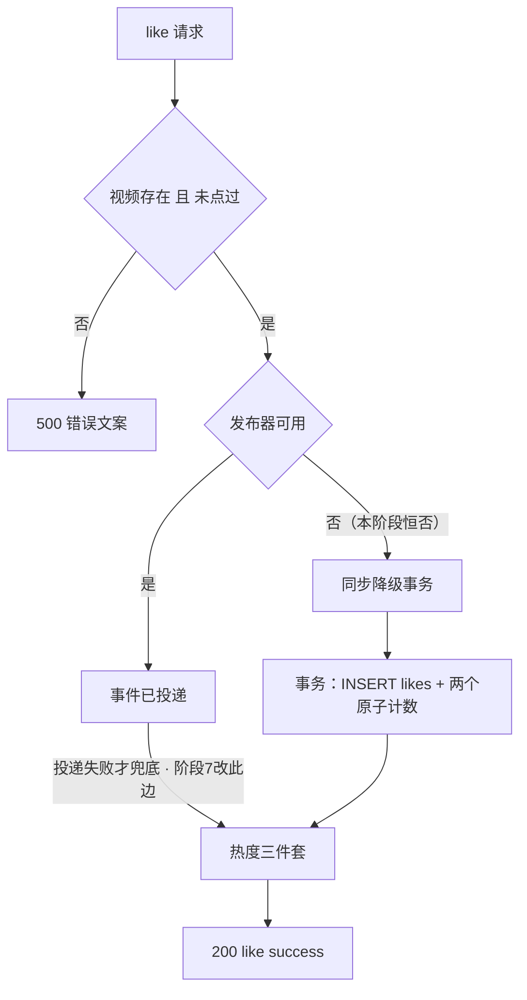

# 阶段 5 · 评论与点赞：并发写挤进两行 SQL

> **本阶段做什么**：评论域（列表、发布、删除、@ 提及）+ 点赞域（点赞、取赞、是否赞过、我赞过的视频），一共 7 个接口。
> **做完能演示**：发评论、@ 人、评论列表、点赞取赞、"我赞过的视频"。
> 点赞看着最简单，却把并发、幂等、缓存一致性全挤在两行 SQL 里；评论的 @ 解析是通知系统的入口。
> **开工前确认**（缺哪条先回对应阶段补，别硬写）：
> - 容器：在 `deploy/` 执行 `docker compose ps`，mysql 与 redis 两行都是 healthy（《02》第 2 步）。
> - 已有的表：`accounts`（《03》第 1 步建）、`videos`/`tags`/`video_tags`/`outbox_msgs`（《04》第 1 步建）。
> - 已有的类：能取出登录账号 id 与用户名的鉴权拦截器（《03》，本阶段把 `/comment/**`、`/like/**` 追加进它的 path 清单）、视频详情缓存与热度封装（《04》）、`RedisKeys`（《02》第 10 步）、限流规则表 `infra/RateLimits.java`（《03》第 1 步建）。
> - 数据：至少 1 个账号 + 1 条视频（前面阶段验收留下的；没有就注册一个、传一条）。

## 第 1 步 · 建 `comments`、`likes`、`notifications` 三张表

MyBatis-Plus 不建表（《02》第 3 步讲过原因），所以本阶段第一件事是手工建表：
`cd deploy && docker compose exec -it mysql mysql -uroot -p123456 feedsystem` 后粘贴

```sql
CREATE TABLE `comments` (
  `id` bigint unsigned NOT NULL AUTO_INCREMENT,
  `username` varchar(191) DEFAULT NULL,
  `video_id` bigint unsigned DEFAULT NULL,
  `author_id` bigint unsigned DEFAULT NULL,
  `content` text,
  `created_at` datetime(3) DEFAULT NULL,
  PRIMARY KEY (`id`),
  KEY `idx_comments_username` (`username`),
  KEY `idx_comments_video_id` (`video_id`),
  KEY `idx_comments_author_id` (`author_id`)
) ENGINE=InnoDB DEFAULT CHARSET=utf8mb4 COLLATE=utf8mb4_0900_ai_ci;

CREATE TABLE `likes` (
  `id` bigint unsigned NOT NULL AUTO_INCREMENT,
  `video_id` bigint unsigned NOT NULL,
  `account_id` bigint unsigned NOT NULL,
  `created_at` datetime(3) DEFAULT NULL,
  PRIMARY KEY (`id`),
  UNIQUE KEY `idx_like_video_account` (`video_id`, `account_id`)
) ENGINE=InnoDB DEFAULT CHARSET=utf8mb4 COLLATE=utf8mb4_0900_ai_ci;

CREATE TABLE `notifications` (
  `id` bigint unsigned NOT NULL AUTO_INCREMENT,
  `recipient_id` bigint unsigned NOT NULL,
  `sender_id` bigint unsigned NOT NULL,
  `type` varchar(50) NOT NULL,
  `target_id` bigint unsigned DEFAULT NULL,
  `content` varchar(255) DEFAULT NULL,
  `is_read` tinyint(1) DEFAULT '0',
  `created_at` datetime(3) DEFAULT NULL,
  PRIMARY KEY (`id`),
  KEY `idx_notifications_recipient_id` (`recipient_id`)
) ENGINE=InnoDB DEFAULT CHARSET=utf8mb4 COLLATE=utf8mb4_0900_ai_ci;
```

两处设计决定后面几步怎么写：`likes` 有自增 `id` 主键 + `(video_id, account_id)` **联合唯一索引**，**重复点赞**和**并发点赞**都靠这个唯一索引兜底（第 5 步的预检只是快速路径）；
`comments.username` 是冗余列，写评论时一起存，读列表时不用再 join `accounts`。

实体与外层类按域分包（都在 `src/main/java/io/github/p_feed/` 下）：`Comment` 实体 + `CommentController/Service/Mapper` 在 `comment/`，`Like` 实体 + `LikeController/Service/Mapper` 在 `like/`，`Notification` 实体在 `notification/`——本阶段第 6 步的 @ 提及要直插它，先把实体建出来（`NotificationController`、`SseHub` 等《08》再写，见《02》第 0 步的结构总览）。

顺手挂限流，下面两步缺一不可（只做第 1 步的话，第 11 条评论**不会**返回 429，因为它根本没经过限流器）：

1. 往《03》第 1 步建的 `infra/RateLimits.java` 里**追加两条**规则——`like_write` 30 次/分钟、`comment_write` 10 次/分钟，都按 token 主体（也就是账号）计。
2. 在《03》第 6 步那个 `WebConfig` 里把四个写接口挂到**限流拦截器**上（那里原本只有 `/account/login`、`/account/register` 两条）：

```java
// 文件：io.github.p_feed.web.WebConfig（已有类：把下面这段追加进《03》第 6 步那个 addInterceptors 方法）
reg.addInterceptor(rateLimit).addPathPatterns(
    "/comment/publish", "/comment/delete", "/like/like", "/like/unlike");
```

键格式与 Redis 挂掉时放行（fail-open）沿用《03》第 6 步的约定；把"逐条 `addPathPatterns`"收口成"按规则表自动生成挂载清单"的完整实现要到《09》第 2 步。

验证（还停在 mysql 里）`SHOW TABLES;`。**通过标志**：数得出 `accounts`、`videos`、`tags`、`video_tags`、
`outbox_msgs`、`comments`、`likes`、`notifications` 八张表，且 `SHOW CREATE TABLE likes` 里
`idx_like_video_account` 是 UNIQUE。
`notifications` 为什么提前到这里建：第 6 步的 @ 提及要往它**直插一行**，没有这张表你这一步就验不了。

## 第 2 步 · 写两个实体和两个 Mapper

`Comment` 的字段就是 `comments` 的列，对外 JSON 是 `{id, username, video_id, author_id, content, created_at}`（`created_at` 是 RFC3339）；`Like` 只有 `id`、`video_id`、`account_id`、`created_at`，不单独对外出现。

- `CommentMapper`：按 `video_id` 查列表、插入、按 `id` 查一条、按 `id` 删。
- `LikeMapper`：插入走 `INSERT IGNORE` 语义并**返回 boolean**（false = 这行本来就存在），删除**返回影响行数**，另有按 `(video_id, account_id)` 计数、按账号查"我赞过的视频"。返回类型现在定死，第 5 步要靠它判断有没有真的动到行。

**通过标志**：`./mvnw test` 绿（给两个 mapper 各补一条"插入后查出来字段一致"的单测）。

## 第 3 步 · 做评论列表 `POST /comment/listAll`

先做读接口，它能立刻验证前两步。本阶段 7 个接口全是 **POST + JSON**。路径 `/comment/listAll`，鉴权**否**，请求 `{video_id}`，成功响应是**裸 Comment 数组**（外面不套 `data`），空为 `[]`。四条规则：
① `video_id` 为 0 或缺失 → **400** `video_id is required`（这是少数几个真返 400 的业务校验）；
② **无缓存**，每次直接查库；③ 先校验视频存在，不存在 → 500 `video not found`；④ `ORDER BY created_at ASC LIMIT 200`——**最早一条在最前**，**无分页字段**，超出 200 条直接截断。

验证：`curl -s --noproxy '*' -XPOST localhost:8081/comment/listAll -H 'Content-Type: application/json' -d '{"video_id":1}'`
**通过标志**：返回 `[]`；换成不存在的视频 id → 状态码 500 且 error 文案是 `video not found`；`{"video_id":0}` → 400 `video_id is required`。

这也是你第一次撞上"业务校验失败也返回 500"：错误响应一律 `{"error": "文案"}`，状态码 **500** 是历史约定，
别"顺手改对"——改了跟参考实现的差分基准就断了；要修正按《03》的错误状态码决策点选 B（语义修正）并记清单。

## 第 4 步 · 发评论与删评论（两个写接口）

`/comment/publish`（POST）：JWT，请求 `{video_id, content}`，成功 `{"message":"comment published successfully"}`。
① `video_id` 为 0 → **400** `video_id is required`；`content` 先 trim，空 → **400** `content is required`；视频不存在 → 500 `video not found`；
② `author_id` 与 `username` **只取登录态**，请求体里传来的同名字段一律忽略；③ 落库后热度 +1：**只动 `popularity`，不动 `likes_count`**（调《04》已实现的封装，效果在第 9 步验）。

`/comment/delete`（POST）：JWT，请求 `{comment_id}`，成功 `{"message":"comment deleted successfully"}`。**只有作者能删**，非作者 → **401** `unauthorized`（401 属身份问题，不在"业务失败 = 500"那条约定里）；`comment_id` 为 0 → **400** `comment_id is required`；
评论不存在 → 500 `comment not found`；删除**不回滚 popularity**——这是事实不是遗漏，别顺手补一段减法。

验证：连发 3 条 → 跑第 3 步的 curl；再拿第二个账号删其中一条、用作者删另一条。**通过标志**：3 条都在列表里且最早在第一位，库里 `author_id`/`username` 等于登录账号；
非作者删 401 `unauthorized`，作者删 200 且列表少一条，两次操作后视频 popularity 都不变。

## 第 5 步 · 点赞与取赞：三条预检加一个事务

`/like/like` 与 `/like/unlike`：都 JWT、请求都是 `{video_id}`，成功分别是 `{"message":"like success"}`、`{"message":"unlike success"}`。
**进预检之前先拦一道**：`video_id` 为 0 → **400** `video_id is required`。
**预检三条**都是 500 + 逐字文案：视频存在（`video not found`）、like 时未点过（`user has liked this video`）、unlike 时已点过（`user has not liked this video`）。

预检只是快速路径，防线是第 1 步那个唯一索引：两个并发请求同时过了预检，也只有一行插得进去。计数与写行必须在**同一事务**内、
用 SQL 里的原子表达式，禁止"读出来加一再写回去"：like → `likes_count+1` 且 `popularity+1`；unlike → 两个都 `-1` 且 `GREATEST(x-1, 0)` 夹底；
unlike 还要看 DELETE 影响行数，0 行就别减计数。

验证：同一账号串行点两次赞、再串行取两次赞。**通过标志**：第二次点赞 500 `user has liked this video` 且计数不变，
第二次取赞 500 `user has not liked this video` 且计数不变。

## 第 6 步 · 在发布路径里解析 @ 并写通知

不是独立接口，是第 4 步 publish 落库成功后多做的一段——整个通知系统从这个口子进来。

1. 正则逐字 `@(\w+)`。`\w` 只匹配 ASCII，所以 `@张三` **不匹配**，保持现状。
2. 匹配结果去重、**跳过自己**（评论人 @ 自己不产生通知）。
3. 按 username 查 `accounts.id`，查不到（例如 `@unknown`）**静默跳过**，不报错也不产生通知。
4. 查到的人往 `notifications` 直插：`type=mention`、`content="<评论人用户名> 在评论中提到了你"`、
   `target_id=` 视频 id、`sender_id=` 评论人、`recipient_id=` 被 @ 的人。
5. **不推 SSE**（《08》也不推它，mention 只进通知列表）。

> 表已经在第 1 步建好，所以这一步可以真跑：用 B 发一条 `@A` 的评论，然后
> `docker compose exec -T mysql mysql -uroot -p123456 feedsystem -e "SELECT type,content,recipient_id FROM notifications ORDER BY id DESC LIMIT 3;"`
> 应当看到一行 `mention`。

**通过标志**：单测四例全绿——重复 @ 同一人 / @ 不存在的用户 / @ 自己 / 中文 @ 不匹配，断言的是"该不该插、插几行、参数是什么"。

## 第 7 步 · 把写路径拆成"发布事件 + 同步降级"

为什么现在就拆：点赞落库这类慢活将来要挪进异步链路（《07》），形状先定好，阶段 7 只换实现、不动调用方。
like / comment 的写路径统一是 **预检 → 发布事件（本阶段恒 Noop=false）→ 降级同步事务**。

```java
// 文件位置：like 包 = src/main/java/io/github/p_feed/like/
public interface LikeEventPublisher {
    /** true=已投递异步链路；false=未启用或失败，调用方必须走同步事务 */
    boolean publishLike(long accountId, long videoId);
    boolean publishUnlike(long accountId, long videoId);
}
```

comment 侧同样建一个窄接口 `CommentEventPublisher`（`boolean publishComment(long commentId, String action)`，
`action` 取值 `publish` / `delete`），放在 `src/main/java/io/github/p_feed/comment/`，本阶段给恒返回 `false` 的 Noop 实现——方法与字段的约定以《07》第 5 步
`EventPublisher` 为准，本阶段只把调用点留好；@ 提及与通知仍是第 6 步的同步直插，不进这条链路。

两个方法本阶段都给恒返回 `false` 的 Noop 实现，调用方拿到 false 就回去走第 5 步那个事务。整条路径如下图
（"发布器可用"这条边本阶段恒走"否"）：



**通过标志**：重构前后第 4、5 步的验证结果一字不差——这一步不该改变任何对外行为。

## 第 8 步 · 两个读接口：isLiked 与"我赞过的视频"

- `/like/isLiked`：JWT，`{video_id}` → `{"is_liked": true}`。对 `likes` 做裸 COUNT 查询，**不走缓存**。
- `/like/listMyLikedVideos`：JWT，`{}` → **裸 Video 数组**，空为 `[]`。实现是 `JOIN likes`，按**点赞时间**排：
  `likes.created_at DESC LIMIT 200`。元素是完整 Video 结构（不是《06》的 `FeedVideoItem`），带 `play_url`，前端拿到就能播。

**验证**：点一个赞后调这两个接口。**通过标志**：isLiked 返回 true；列表第一条是刚点的视频且带 `play_url`；取赞后两处都回退。

## 第 9 步 · 接上热度三件套，验并发与降级

本阶段（没有 MQ）三条写路径**无条件**调《04》第 6 步定义的 `updatePopularityCache(videoId, delta)`：评论发布 `+1`、点赞 `+1`、取赞 `-1`。
> 预告一句，免得阶段 7 回来找不到：接上 Kafka 后这条调用要变成**条件兜底**——只有热度事件投递失败时才调它，投递成功就交给 `PopularityConsumer`，否则分钟窗口会双计。改法见《07》第 7 步。它做三件事（细节以《04》第 6 步那四条为准，这里只补一句"谁改列"）：
DEL `v1:video:detail:id={id}` + DEL `v1:video:entity:{id}` + `ZINCRBY v1:hot:video:1m:{yyyyMMddHHmm}`
（key 取 **UTC 当前分钟**，每次写都重设 **TTL 2 h**），ZINCRBY 与 EXPIRE 共用一个 **50 ms** 超时、
`videoId==0` 或 `delta==0` 直接 return；失败在原版是**静默丢弃**（`_ = cache.Del(...)` 这种写法，连日志都没有）。Java 侧顺手 `log.warn` 属于有意增强，记进差异清单，别说成原版行为。

> 注意：**本阶段**（还没有 MQ）`videos.popularity` 这一列的 SQL 更新由这三个 service 自己做
> （`UPDATE videos SET popularity = popularity + ?`），它**不在**封装里。原版同样分开：
> `comment_service.go` / `like_service.go` 改列，再调那个函数动缓存。
> 接上 Kafka 之后（《07》第 7 步）改列的活儿交给 `LikeConsumer` / `CommentConsumer`，service 只在投递失败时兜底。

补三条测试：并发单测 ×2（双线程 like 同一视频 → 只落 1 行且计数 +1；双 unlike → 只减一次）、集成测试（点赞后 detail + entity 两键都消失、分钟窗口 ZINCRBY 正确）、降级测试。
降级测法：`cd deploy && docker compose stop redis`。
**通过标志**：`./mvnw test` 全绿；Redis 停着点赞仍 200（缓存步骤静默跳过）；重启 Redis 后 `likes_count` 仍对。

## 本阶段验收清单

```bash
# 1) 7 个接口跑一遍成功 + 失败路径，文案逐字比对第 3~8 步的接口行
# 2) 并发 20 like → likes 表 1 行、likes_count=1
# 3) 删评论 → popularity 不变
# 4) 同一个视频发 250 条评论 → listAll 返回 200 条且正序（最早的在最前）
# 5) cd deploy && docker compose stop redis 期间点赞仍 200，start 回来计数仍对
# 6) 限流 11 条评论 → 第 11 次 429（《03》第 6 步的 RateLimitInterceptor 已在，本阶段往规则表追加 like_write / comment_write 两条并挂上路径）
```

六条全绿 = 阶段 5 完成，进《06》。**《06》第 1 步会先让你建 `socials` 表。**

## 卡住了看这里

**`likes_count` 变负数。** 原因：减法没夹底，或降级事务执行两次却没判影响行数。处理：`GREATEST` + DELETE 影响行数判断缺一不可。

**并发 like 落了多行。** 原因：唯一索引没建，或"先查再插"没配 `INSERT IGNORE`。处理：以唯一索引为准；捕获 DuplicateKey 转成"已点过"。

**中文 @ 不产生通知。** 原因：`\w` 只匹配 ASCII——这是规格（第 6 步），不是 bug。处理：想支持中文属于功能演进，写进差异清单再动。

**listAll 顺序两版不一致。** 原因：同秒评论的次序未定义（ASC 只按 created_at）。处理：属可接受偏差；要稳定可加 `, id ASC` 并记差异。

**详情缓存里点赞数不更新。** 原因：只删了 detail 没删 entity。处理：三件套必须整体复用《04》的封装（第 9 步），别手写单键删除。
