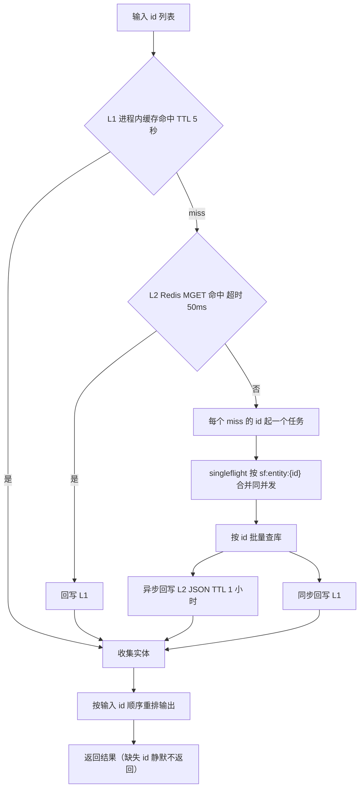
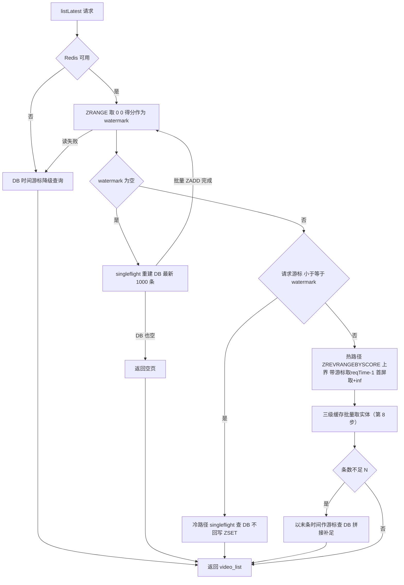
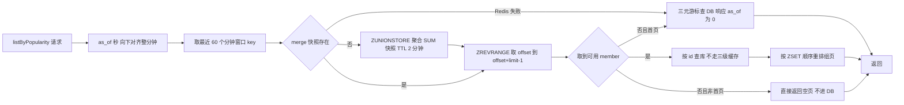

# 阶段 6 · 关注关系与 Feed 时间线：五种列表五种取数

> **本阶段做什么**：关注域（关注、取关、粉丝列表、关注列表、两个计数）+ Feed 域（推荐流、点赞榜、关注流、热榜、话题页）。
> **做完能演示**：关注 / 取关、推荐流、点赞榜、关注流、热榜、话题页。
> **开工前确认**（缺哪条先回对应阶段补，别硬写）：
> - 容器：在 `deploy/` 执行 `docker compose ps`，mysql 与 redis 两行都是 healthy（《02》第 2 步）。
> - 已有的表：`accounts`、`videos`、`tags`、`video_tags`、`outbox_msgs`、`comments`、`likes`、`notifications` 八张
>   （《03》《04》《05》各自的第 1 步建的）——第 1 步会用 `SHOW TABLES;` 核对，少一张就是前面跳了步。
> - 已有的类：硬 JWT 鉴权拦截器（《03》）、`RedisKeys`（《02》第 10 步）、限流规则表 `infra/RateLimits.java`（《03》第 1 步）、
>   热度三件套 `updatePopularityCache`（《05》第 9 步，热榜要读它写的窗口）、detail 缓存那套"锁 + double check"模式（《04》）。
> - 数据：库里已有一批测试视频和互动数据（跑过《00》第 6 节可直接复用原版数据；没跑过就用自己前几阶段攒的视频、评论、点赞，够用就行）。
> **预计用时**：2-3 天。
>
> Feed 流是"短视频系统"这个词里的本义，五种列表的取数策略各不相同。本阶段的收获不是代码量，而是三种分页思想：
> **时间游标**（给我"比这个时间点更早的 N 条"）、**复合游标**（排序键不唯一时把主键追加进游标，保证不重不漏）、
> **快照 + 偏移**（先冻结一份榜单快照，再放心地按 offset 翻页）。软鉴权（不带 token 也能匿名浏览）在本阶段第一次派上用场。

## 第 1 步 · 建 `socials` 表

MyBatis-Plus 不建表（《02》第 3 步讲过原因），第一件事还是建表：
`cd deploy && docker compose exec -it mysql mysql -uroot -p123456 feedsystem` 后粘贴

```sql
CREATE TABLE `socials` (
  `id` bigint unsigned NOT NULL AUTO_INCREMENT,
  `follower_id` bigint unsigned NOT NULL,
  `vlogger_id` bigint unsigned NOT NULL,
  PRIMARY KEY (`id`),
  UNIQUE KEY `idx_social_follower_vlogger` (`follower_id`, `vlogger_id`),
  KEY `idx_social_follower` (`follower_id`),
  KEY `idx_social_vlogger` (`vlogger_id`)
) ENGINE=InnoDB DEFAULT CHARSET=utf8mb4 COLLATE=utf8mb4_0900_ai_ci;
```

一行关系 = 一次关注：`follower_id` 是发起关注的人，`vlogger_id` 是被关注的人；
唯一索引保证同一对关系只有一行，**取消关注是 DELETE**（不是打标记）。

顺手挂限流：往《03》第 1 步建的 `infra/RateLimits.java` **追加**一条 `social_write` 20 次/分钟（按 token 主体也就是账号计）。
本阶段只把规则挂上，按规则表拦截的完整实现要到《09》。

验证（还停在 mysql 里）：`SHOW TABLES;`。**通过标志**：到这一步为止库里应当有
`accounts`、`videos`、`tags`、`video_tags`、`outbox_msgs`、`comments`、`likes`、`socials` **八张表**。

## 第 2 步 · 写关注与取关两个接口

五个 `social` 接口全在 `/social` 组、全部需登录；`follow` 与 `unfollow` 挂第 1 步那条限流 `social_write` 20 / 分钟 / 账号。
本阶段要写的类如下（后面各步逐个补齐，先建空壳让 IDE 帮你分层）：

```text
SocialController / SocialService / SocialMapper
FeedController   / FeedService   / FeedMapper / TimelineRedisService
VideoEntityCache                  ← 第 8 步的三级缓存
SoftJwtAuthInterceptor            ← 只有"完全不带头"才匿名；带了头就必须通过，否则 401
```

`POST /social/follow`：校验顺序固定为**参数 → 双方账号存在 → 不能关注自己 → 不能重复关注**，
逐字文案 `vlogger_id is required`(400)、`can not follow self`、`already followed`。
`POST /social/unfollow`：**参数 → 必须已关注**，文案 `vlogger_id is required`(400)、`not followed`。
成功文案也要逐字：follow → `{"message":"followed"}`、unfollow → `{"message":"unfollowed"}`（都是 200）。
三条状态机文案（`can not follow self`、`already followed`、`not followed`）走业务错误通道，**默认 500**——
与《05》第 3 步的 500 历史约定同一套，参数缺失才是 400。

**幂等防线**：先查后插只是省代价，真防线是唯一索引 `(follower_id, vlogger_id)` 兜底并发。
**写序固定**：先 `INSERT socials` → 再失效关注流缓存（第 7 步才有东西可失效，先留一个空函数）→
最后调用**消息发布器**。接口形状在这里定死（《07》第 7 步会给它加一个 Kafka 实现并委托过去）：

```java
public interface SocialEventPublisher {
    /** false = 没投出去，调用方必须走同步兜底 */
    boolean publishFollow(long followerId, long vloggerId);
    boolean publishUnfollow(long followerId, long vloggerId);
}
```

本阶段只提供 `NoopSocialEventPublisher`（直接 `return false`，于是永远走同步路径），仅用于给对方发通知，失败直接吞掉只记日志。
unfollow 同样三步，但不产生通知。

验证：注册两个账号，A 关注 B、A 关注 A、A 重复关注、A 取关、再取关。
**通过标志**：关注→取关→再关注三种文案各命中一次；重复关注与重复取关不产生第二行 `socials`。

## 第 3 步 · 三个查询接口：粉丝、关注、计数

- `POST /social/getAllFollowers`：粉丝列表 + 粉丝数。
- `POST /social/getAllVloggers`：关注列表 + 关注数。
- `POST /social/getCounts`：两个计数。

两条取数规则：① 列表先用 `socials` 查关联 id（**LIMIT 200，无 ORDER BY**）→ 再按 id 批量查 `accounts`；
② 粉丝数 / 关注数**全部实时 COUNT `socials`**，无计数列、无缓存——这是用性能换正确性的取舍，别"优化"成计数列。

**通过标志**：A 关注 B 后，B 的 followers 里有 A、A 的 vloggers 里有 B，`getCounts` 两个数各加一；取关后全部回退。

## 第 4 步 · Feed 的公共底座：软鉴权 + limit 归一 + 一条组装函数

五个端点全在 `/feed` 组；`listByFollowing` 硬 JWT（复用《03》那个拦截器），其余四个走**软鉴权**。
先写 `SoftJwtAuthInterceptor`，规则只有一条分界：**请求完全没有 `Authorization` 头** → 匿名放行（viewer=0，所有 `is_liked` 一律 false）；**只要带了头**，就和硬鉴权一样严格——非 `Bearer` 格式 → 401 `invalid authorization header`、验签/过期失败 → 401 `invalid or expired token`、白名单不符 → 401 `token has been revoked`。"带了坏头当匿名"是错的：那等于给伪造 token 开了后门。
但带了合法格式的头就必须验签通过，不能"松"成伪造可用。limit 一律：`<=0 或 >50 → 10`。

所有 Feed 接口的元素结构 `FeedVideoItem` 逐字如下（注意 `create_time` 是**秒**）：

```jsonc
{"id":1, "author":{"id":1,"username":"u"}, "title":"t", "description":"d"(可省略),
 "play_url":"...", "cover_url":"...",
 "create_time":1756814652,          // 秒
 "likes_count":3, "is_liked":false}
```

再写 `buildFeedVideos`：把一组视频 id 组装成上面的元素，其中 `is_liked` 必须**批量**判断——
`WHERE video_id IN (...) AND account_id=?` 一次查完，别在循环里逐条查。
游标 DTO 用可空 `Long` 判"未传"；RFC3339 时间字段用 `OffsetDateTime` + `JavaTimeModule`。

**验证**：给 `buildFeedVideos` 写单测（同一批 id，分别按登录态与匿名各组装一次）。
**通过标志**：不带 Authorization 的请求返回 200 且 `is_liked` 全 false；limit 传 0 / 51 实际返回 10 条。

## 第 5 步 · `FeedMapper` 六条查询与三种分页的 SQL

排序 `ORDER BY a DESC, id DESC` 时，续翻的 WHERE 条件必须写成复合形式（先背这个）：

```sql
WHERE (a < :a0) OR (a = :a0 AND id < :id0)
```

`listLikesCount` 是二元版（a = likes_count）；`listByPopularity` 的 DB 兜底是三元版（a = popularity，第二排序键是 create_time）。
加主键 `id` 正是为了排序键相等时游标仍然全序。三种分页的 SQL 用 MyBatis `<script>` 或两三个 `<if>` 拼装。

六条查询按接口写全，第 6~10 步会逐条用到。本阶段第一个能跑通的 Feed 接口是 `listByTag`：
请求 `{tag_name, limit}`，响应只有 `{video_list}`，**无分页游标**。

验证：游标单测——时间游标 / 二元 / 三元各翻 3 页无重无漏（用参数化测试造 30 条数据翻页验证）。
**通过标志**：三个参数化测试绿；`/feed/listByTag` 返回 `{video_list}`，空话题返回 `[]`；`tag_name` 为空 → **400** `tag_name is required`。

## 第 6 步 · 点赞榜 `listLikesCount`：第一个复合游标

`POST /feed/listLikesCount`（软鉴权）：请求 `{limit, likes_count_before?, id_before?}`，
响应 `next_likes_count_before?, next_id_before?, has_more`，游标单位是**整数**（不是时间）。

校验细节（原版逐条文案，全部 **400**，差分测试要按字断言）：
   - 只传 `likes_count_before` 或只传 `id_before` → `likes_count_before and id_before must be provided together`
   - `likes_count_before < 0` → `invalid cursor: likes_count_before must be >= 0`
   - `id_before <= 0` → `invalid cursor: id_before must be > 0`
   - 热榜/时间类游标不成对 → `latest_before and latest_id_before must be provided together`
   - 两个都为 0 视为第一页
翻页时前端要把上一响应里的两个 `next_*` 原样回传。

验证：造 30 条点赞数各不相同的视频（第 5 步参数化测试用的那批即可），翻三页。
**通过标志**：三页无重无漏；只传 `likes_count_before` 不传 `id_before` → 400。

## 第 7 步 · 关注流 `listByFollowing`：DB 拉取 + 整页缓存

`POST /feed/listByFollowing`（**硬 JWT**）：请求 `{limit, latest_time}`，响应 `next_time, has_more`，游标单位是**秒**。

1. SQL：`author_id IN (SELECT vlogger_id FROM socials WHERE follower_id=我)` + `create_time < 游标`（单位：**秒**）+ DESC + LIMIT。
   **纯拉模型**——发视频不写任何粉丝的收件箱（全局 ZSET 只服务推荐流，这就是本项目"推拉结合"的取舍）。
2. 整页响应缓存：**只有登录用户才缓存**（原版判据是 `viewerAccountID != 0`，匿名请求每次直查 DB）。
   键的完整模板是 `v1:feed:listByFollowing:limit={limit}:accountID={id}:before={秒}`（首屏 `before=0`），TTL **24 h**，value 是整页响应 JSON。SCAN 失效时用前缀模式即可。
   miss 时抢分布式锁（TTL **500 ms**）+ double check + 5×20 ms 轮询——与《04》detail 缓存同一套模式，
   只是缓存对象换成了整个响应 JSON。注意 **500 ms 是 Feed 页的锁**，阶段 4 详情锁是 2 s，别混。
3. 回填第 2 步留的空函数：关注 / 取关要 SCAN 失效模式 `v1:feed:listByFollowing:*:accountID={谁的关注变了}:*`——
   **禁用 KEYS**，实现用 `redis.scan(ScanOptions...)` 迭代 + 批量 DEL；失效的是**关注者自己**的页缓存（他的关注列表变了）。

> **警告**：缓存 value 含 `is_liked` 这种**按人而异**的数据，key 必须含 accountID。
> 把它改成公共缓存是数据泄露级别的错误设计，三思而后改。

验证（在 `deploy/` 下）：`docker compose exec -T redis redis-cli --no-auth-warning -a 123456 --scan` 先看键的形状（带模式即 `docker compose exec -T redis redis-cli --no-auth-warning -a 123456 --scan --pattern 'v1:feed:listByFollowing:*'`）；关注一个新博主后立刻刷关注流。
**通过标志**：同一 accountID 第二次请求命中整页缓存（DB 无查询日志）；新关注的博主视频**立即**出现在第一页，SCAN 失效真的删到了键。

## 第 8 步 · `VideoEntityCache`：三级缓存 + 请求合并

推荐流热路径要按一批 id 取实体，逐条查库会打穿 DB。这一步做的 `GetVideoByIDs` 就是三层缓存加同 id 合并：

```text
输入: [101, 102, ...]
L1  进程内 Caffeine，TTL 5 秒        —— 逐 id 命中则收集，miss 进 L2
L2  Redis MGET v1:video:entity:{id}  —— 单次 50 ms 超时；命中回写 L1
L3  每个 miss 的 id 一个任务：
    singleflight(key=sf:entity:{id}) 合并同 id 并发
    → 按 id 批量查库
    → 异步回写 L2（JSON，TTL 1 h，写失败仅日志）
    → 同步回写 L1
最后按输入 id 顺序重排输出（找不到的 id 静默缺失）
```

实现要点：L1 用 Caffeine `maximumSize(2000).expireAfterWrite(5s)`（**L1 的 5 秒以本篇为准**；原版用 go-cache 也是每次写入显式 5 秒 TTL，语义接近，不用为了对齐改）；
L2 是 Redis MGET `v1:video:entity:{id}`（String，TTL **1 h**，value 是 Video 实体 JSON，RFC3339 时间），
单次 **50 ms** 超时，超时即视为 miss 下沉 L3；L3 每个 miss 的 id 一个任务（虚拟线程或固定线程池均可），
singleflight 用 `ConcurrentHashMap<Long, CompletableFuture<Video>>` + `computeIfAbsent` + finally remove，
> 说明：原版给这些去重键拼了 `sf:entity:{id}`、`sf:cold:listLatest:{limit}:{reqTime}`、`sf:stitch:listLatest:{n}:{ts}`、`sf:fallback:global_timeline_rebuild` 这样的字符串——它们是**进程内 map 的键**，从不写进 Redis。所以《08》的缓存地图里没有它们，`redis-cli --scan` 也扫不到；别照着它们去建 Redis 键。
按 `sf:entity:{id}` 把同 id 并发合并成一次查库。

本阶段只新增一个依赖（版本由 Boot BOM 托管，**不写 `<version>`**）：

```xml
<dependency>
    <groupId>com.github.ben-manes.caffeine</groupId>
    <artifactId>caffeine</artifactId>
</dependency>
```



缓存 value 是 **Video 实体的 JSON**（字段与 tag 见《04》），所以 Java 与参考实现会互读互写，序列化兼容性在《08》统一测试。
**验证**：并发合并单测——100 并发 miss 只打 1 次库。**通过标志**：该单测绿；三级全 miss 时结果顺序与输入 id 顺序一致。

## 第 9 步 · 推荐流 `listLatest`：冷热分离的时间线（本阶段最难的一段）

`POST /feed/listLatest`（软鉴权）：请求 `{limit, latest_time}`，响应 `next_time, has_more`，游标单位是**毫秒**。
Redis 侧只有一个键 `v1:feed:global_timeline`：ZSET，score = 发布时间**毫秒**，**只保留最新 1000 条**；
它由阶段 7 的消费者维护（《07》），**本阶段用 `ZADD` 手工造数据**。ZSET 操作全走 `StringRedisTemplate` 的
`ZSetOperations`，读写逻辑放在 `TimelineRedisService`。六条规则（先照做，图在后面）：

1. `ZRANGE timeline 0 0` 取窗口里最老一条的分数，作为冷热分界线 watermark。
2. Redis 不可用 → 直接走 DB 降级查询（普通时间游标）。
3. ZSET 为空（冷启动）→ singleflight 合并重建：DB 拉最新 1000 条 → 批量 ZADD → 重入本流程一次（DB 也空则直接返回空页，防死循环）。
4. 请求游标 ≤ watermark → **纯冷路径**：singleflight 查 DB，**不回写 ZSET**（防冷数据污染热窗口）。
5. 否则**热路径**：`ZREVRANGEBYSCORE` 下界 `-inf`，**上界分两种**——带游标时用 `reqTime-1`（防重复），首屏（没传游标）时是 `+inf`；取 N 个 member →
   批量走第 8 步的三级缓存拿实体 → 不足 N 条（正好击穿冷热边界）时，用本页最后一条的时间做游标查 DB 补足并拼接（stitch）。
6. `next_time` = 末条视频发布时间毫秒；`has_more` = 本页是否满条。



验证：`ZADD` 手工造窗口数据测热路径 → 清空 ZSET 测重建 → 把游标调老测冷路径与拼接。
**通过标志**：热路径不打 DB；冷路径不写 ZSET；`FLUSHDB` 之后仍然 200（走 DB 降级）。

## 第 10 步 · 热榜 `listByPopularity`：60 分钟滑动窗口 + 快照冻结

`POST /feed/listByPopularity`（软鉴权）：请求 `{limit, as_of, offset, latest_popularity, latest_before, latest_id_before?}`，
响应除了 `video_list` 还有 `as_of, next_offset, has_more, next_latest_*`；`as_of` 与 `latest_before` 是**秒 / RFC3339 字符串**两套单位。
校验：`latest_popularity < 0` → **400** `latest_popularity must be >= 0`（`feed/handler.go:138-139`，原版少数写死 400 的校验之一）。

数据源是《05》热度三件套里的 `updatePopularityCache`：它一直在往 `v1:hot:video:1m:{yyyyMMddHHmm}` 做 `ZINCRBY`（TTL 2 h）。

1. `as_of`（秒）取请求值并**向下对齐到整分钟**；第一页传 0 → 用服务器当前分钟。
2. 取最近 **60** 个分钟窗口的 key 列表。
3. 快照 key `v1:hot:video:merge:1m:{as_of分钟}` 不存在时 `ZUNIONSTORE 快照 SUM 60个窗口`，TTL **2 分钟**。
   **同一 as_of 的所有翻页复用这份快照**——这就是"翻页期间榜单不跳动"的原理，也是本接口存在的意义（面试高频）。
   `ZUNIONSTORE` 用 `opsForZSet().unionAndStore`（aggregate=SUM 是默认值）。
4. `ZREVRANGE 快照 offset .. offset+limit-1` → 解析 member 为 id → 按 id 查库（这条路径**不走**三级缓存）→
   按 ZSET 顺序重排 → 组页。
5. 响应同时给两套游标：Redis 路径的 `{as_of, next_offset}`，以及 DB 兜底所需的三元游标
   `{next_latest_popularity, next_latest_before, next_latest_id_before}`。
6. 三分支要分清（照抄原版 `feed/service.go` 的控制流）：
   - ZREVRANGE **报错** → 走 DB 三元游标兜底，响应 `as_of=0`（0 就是"我在走兜底"的标记）；
   - **读成功但结果为空且 offset>0** → 直接返回空页：`video_list=[]`、`as_of` 保持真实值、`next_offset=offset`、`has_more=false`，**不进 DB**；
   - 读成功但结果为空且 offset==0（首页）→ 才落 DB（`as_of=0`）。



验证：对某视频疯狂点赞后连翻几页。**通过标志**：热榜第一页 1 分钟内不变（快照生效）→ 跨分钟后排名更新；停掉 Redis 仍 200（`as_of=0`）。

## 第 11 步 · 全链路降级与前端联调

软鉴权拦截器接入四个公开流（`listLatest`、`listLikesCount`、`listByPopularity`、`listByTag`），
前端指向 8081：推荐流下拉翻页、关注流、热榜、话题页全部正常。然后做破坏性验证：

```bash
# cd deploy && docker compose exec -T redis redis-cli --no-auth-warning -a 123456 FLUSHDB → 五种流仍全部 200（全走 DB 降级），再逐步把窗口/缓存喂回来
```

**通过标志**：`FLUSHDB` 之后五种流全部 200，逐个恢复后走缓存路径——参考实现就是这样，逐项对齐。

## 本阶段验收清单

可选差异测试（与参考实现并行双跑，测试账号两边分开用，避免互踢；没跑过阶段 0 可跳过）：

```bash
# 1) 同一匿名请求（无 Authorization 头）分别打 8080 / 8081，五种流各翻 3 页：
#    video_list 的 id 序列、has_more 序列一致
# 2) 新关注一个博主后，其视频立即出现在自己关注流第一页（证明 SCAN 失效真的删到了）
# 3) 对某视频疯狂点赞 → 热榜第一页 1 分钟内不变 → 跨分钟后排名更新
# 4) FLUSHDB 后五种流全部仍 200（全走 DB 降级）
# 5) limit 传 0 / 51 → 实际返回 10 条；listLikesCount 只传一个游标字段 → 400
# 6) 三级缓存：100 并发只产生 1 次查库；Redis 挂掉时 listLatest 走 DB 且仍 200
```

六条全绿 = 阶段 6 完成。异步化（把第 2 步的消息发布器换成真链路、让第 9 步那个 ZSET 由消费者维护）在《07》。

## 卡住了看这里

**翻页永远返回第一页。** 原因：游标单位搞错（毫秒当秒用），或者前端回传字段名拼错。
处理：对照第 6~10 步各自的单位；用 `TTL` / 日志看请求值。

**与参考实现的 `listLatest` 顺序不同。** 原因：热窗口里同一毫秒有多条，ZSET 按 member 字典序断 ties；
DB 冷拼接部分对不上。原因不是精度——`videos.create_time` 两边都是 `datetime(3)`（毫秒），差的是**时区偏移**：Go 驱动按 `loc=Local` 读写，Java 侧若用 `LocalDateTime` 就丢了偏移。处理：先比 id 集合再比顺序；实体统一 `OffsetDateTime`（见《04》第 1 步与《08》序列化契约）。

**is_liked 全 false（明明点过赞）。** 原因：软鉴权拦截器没把 viewer id 放进 request 属性，或属性名与参考实现不一致。
处理：从 interceptor 断点查起，这是 plumbing bug 而非逻辑 bug。

**关注流缓存 24 h，刚关注的博主刷不到。** 原因：忘了实现 SCAN 失效，或 key 模式与第 7 步写下的模式不一致。
处理：`cd deploy && docker compose exec -T redis redis-cli --no-auth-warning -a 123456 --scan --pattern 'v1:feed:listByFollowing:*'` 先看 key 形状再修。

**读参考实现写的 entity 缓存直接反序列化异常。** 原因：Video JSON 的 `create_time` 是 RFC3339 带时区偏移，Jackson 默认不认。
处理：`JavaTimeModule` + `ADJUST_DATES_TO_CONTEXT_TIME_ZONE=false`；《08》会把这类兼容测试系统化，先按能跑处理。
