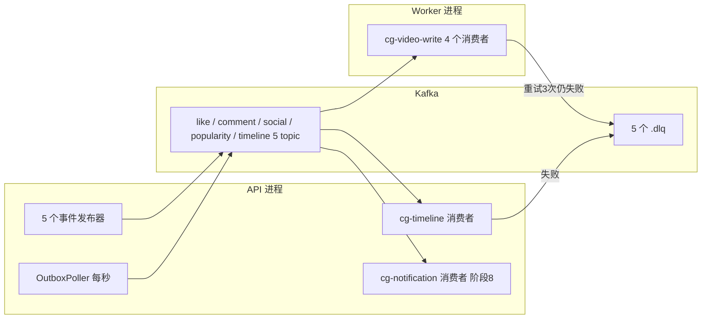

# 阶段 7 · Kafka 异步化

> **本阶段做什么**：把点赞、评论、关注、热度这些"慢活"从 HTTP 请求里搬出去，交给 Kafka 和后台消费者；
> Kafka 不可用时自动退回同步写库，用户无感。
> **做完能演示**：点赞先拿 200，毫秒级后库里出现记录；停掉 broker，点赞依然成功（降级路径）。
> **开工前确认**：`deploy/docker-compose.yml` 里 mysql/redis 在跑（《02》第 2 步）；
> 库里的九张表应该都在（`accounts` `videos` `tags` `video_tags` `outbox_msgs` `comments` `likes` `notifications` `socials`，
> 最后一张 `messages` 要等《08》；本阶段主战场是前六张，`SHOW TABLES` 时别因为少了 `tags`/`video_tags`/`notifications` 而以为缺表）；
> 阶段 5/6 留下的是**各域自己的窄接口**（如《05》的 `LikeEventPublisher`）+ Noop 空实现，本阶段补上真实现并让它们真的投递。

## 先看一张图（30 秒，不求看懂细节）



一句话读法：发送方只管"发出去"，Worker 进程慢慢消费落库；同一条消息可以被不同的**消费者组**各消费一次
（上图里 `cg-video-write` 落库、`cg-notification` 发通知），这就是 Kafka 的扇出，
不需要为一个用途建一个队列。消费失败的消息进 `.dlq`（死信队列）等人工看。

---

## 第 1 步 · 把 Kafka 容器加进依赖清单

在**你自己的** `deploy/docker-compose.yml` 里加一个服务。位置要说清楚：文件末尾有一段顶层
`volumes:`（与 `services:` 平级），Kafka 必须插在**那段之前**、与 `mysql:` / `redis:` 平级：

```yaml
  kafka:
    image: apache/kafka:latest        # KRaft 模式，无需 Zookeeper
    restart: always
    ports: ["9092:9092", "9093:9093"]
    environment:
      KAFKA_NODE_ID: 1
      KAFKA_PROCESS_ROLES: broker,controller
      KAFKA_LISTENERS: PLAINTEXT://:9092,CONTROLLER://:9093
      KAFKA_ADVERTISED_LISTENERS: PLAINTEXT://localhost:9092
      KAFKA_CONTROLLER_LISTENER_NAMES: CONTROLLER
      KAFKA_CONTROLLER_QUORUM_VOTERS: 1@localhost:9093
      KAFKA_LISTENER_SECURITY_PROTOCOL_MAP: CONTROLLER:PLAINTEXT,PLAINTEXT:PLAINTEXT
      KAFKA_OFFSETS_TOPIC_REPLICATION_FACTOR: 1
      KAFKA_GROUP_INITIAL_REBALANCE_DELAY_MS: 0
      KAFKA_LOG_DIRS: /tmp/kraft-combined-logs
```

> 说明：`ADVERTISED_LISTENERS` 必须是宿主机能访问的地址（localhost:9092）。
> 写成容器内地址是 Kafka 容器化第一大坑——客户端能连上却永远拿不到数据。
> 另外 Kafka 这里没挂数据卷，日志在容器内 `/tmp` 下：`docker compose down`（删容器）会丢消息，
> 学习和降级演练够用；想持久化就照 MySQL 那样给它加一个 volume + 把 `KAFKA_LOG_DIRS` 指过去。

```bash
cd deploy
docker compose config --services     # 期望列出 kafka / mysql / redis 三行（YAML 缩进错了这里就报错）
docker compose up -d kafka
docker compose ps                    # kafka 应为 Up；这个镜像不保证带 healthcheck，别等 (healthy) 字样
docker compose exec kafka /opt/kafka/bin/kafka-topics.sh --bootstrap-server localhost:9092 --list
```

**通过标志**：最后一条命令不报错（返回空列表或内置 topic 都算成功）。

## 第 2 步 · 建 10 个 topic（5 业务 + 5 死信）

你的 shell 是 fish，`for` 循环语法和 bash 不同，所以写成脚本文件。新建 `deploy/create-topics.sh`：

```bash
#!/usr/bin/env bash
# 文件：deploy/create-topics.sh
set -e
cd "$(dirname "$0")"
BROKER=localhost:9092
create() {
  docker compose exec -T kafka /opt/kafka/bin/kafka-topics.sh \
    --bootstrap-server "$BROKER" --create --if-not-exists \
    --topic "$1" --partitions "$2" --replication-factor 1
}
for t in like-events comment-events social-events video-popularity video-timeline; do
  create "$t" 3          # 业务 topic 3 分区
  create "$t.dlq" 1      # 死信队列 1 分区
done
docker compose exec -T kafka /opt/kafka/bin/kafka-topics.sh --bootstrap-server "$BROKER" --list
```

跑一次（topic 只需建一次，脚本可重复执行）：

```bash
bash deploy/create-topics.sh        # 期望末尾列出 10 个 topic
```

本阶段与阶段 8 用到的 topic 契约（**谁发、谁消费都写死在这张表**）：

| topic | 消息 key | 谁发 | 谁消费（消费者组） |
|-------|----------|------|--------------------|
| `like-events` | videoId | LikeService | `cg-video-write`（Worker）；`cg-notification`（API，阶段 8 接） |
| `comment-events` | videoId | CommentService | 同上两组 |
| `social-events` | followerId | SocialService | 同上两组 |
| `video-popularity` | videoId | Like/CommentService | `cg-video-write` |
| `video-timeline` | videoId | OutboxPoller（API） | `cg-timeline`（API） |
| `<上面每个>.dlq` | 原样 | 消费者（失败时转投） | 无人消费，人工排查 |

**通过标志**：`--list` 输出 10 行 topic 名。

## 第 3 步 · 手工收发一次，先确认链路通

不通的话，后面写 Java 代码时你分不清是代码问题还是容器问题。三条命令：

```bash
cd deploy
# 发：敲一行 JSON 回车，Ctrl-C 退出
docker compose exec -it kafka /opt/kafka/bin/kafka-console-producer.sh \
  --bootstrap-server localhost:9092 --topic like-events \
  --property parse.key=true --property key.separator=\t
# 收：--from-beginning 会把刚发的读出来，Ctrl-C 退出
docker compose exec -it kafka /opt/kafka/bin/kafka-console-consumer.sh \
  --bootstrap-server localhost:9092 --topic like-events --group smoke --from-beginning
```

发送端输入（`key` 与 JSON 之间用一个 Tab 分隔；`parse.key=true` 会把 Tab 左侧作为消息 key）：

```text
2	{"event_id":"smoke1","action":"like","user_id":1,"video_id":2,"occurred_at":"2026-09-03T10:00:00Z"}
```

消费端如需同时打印 key，追加 `--property print.key=true --property key.separator=\t`（fish 写法，见下方注意）。

> **fish 用户的坑（2026-09-28 实测）**：`$'\t'` 是 bash 的 ANSI-C 引用，fish 会报"在变量 $ 之后没有变量名"；fish 的等价写法是**不加引号**的 `\t`，它会展开成真正的 Tab。上面的命令已按 fish 写法给出；bash 用户仍用 `$'\t'`。

**通过标志**：消费端原样打印出这行 JSON。看到它，说明 broker、端口、监听器配置三件事都对了。

## 第 4 步 · 加依赖与配置（到这一步才需要）

`pom.xml` 里加 Kafka 官方客户端。**不写版本号**——Boot 4.0.8 的依赖清单已经管理了它
（`spring-boot-dependencies` 里 `kafka.version=4.1.2`），自己钉一个版本只会和 parent 打架：

```xml
<dependency>
    <groupId>org.apache.kafka</groupId>
    <artifactId>kafka-clients</artifactId>
</dependency>
```

验一下它真的解析到了：`./mvnw dependency:tree -Dincludes=org.apache.kafka`（期望出现 `kafka-clients:jar:4.1.2`）。**别用 `-q`**：实测本项目的 `./mvnw -q dependency:tree` 会输出 0 行（树走 INFO 日志、被 `-q` 吞掉）。

`application.yml` 的 `feed:` 段下追加（`feed:` 已存在，**并进原块**，别写成两个顶层 `feed:`）：

```yaml
feed:
  kafka:
    bootstrap: ${KAFKA_BOOTSTRAP:localhost:9092}
  outbox:
    fixed-delay-ms: 1000        # 第 8 步的轮询间隔
    batch-size: 100             # 第 8 步每次最多取多少行
```

`AppProps` 相应加两个嵌套 record（《02》第 7 步预告过"后面各阶段往里加"）：

```java
// 文件：io.github.p_feed.config.AppProps（已有类：追加 kafka / outbox 两个嵌套 record）
@ConfigurationProperties(prefix = "feed")
public record AppProps(Redis redis, Jwt jwt, Kafka kafka, Outbox outbox) {
    // redis / jwt 已有，这里新增 kafka 与 outbox
    public record Kafka(String bootstrap) {}
    public record Outbox(long fixedDelayMs, int batchSize) {}
}
```

**通过标志**：`./mvnw -q compile` 通过，重启应用不报绑定失败。

## 第 5 步 · 生产者：连不上就降级，而不是抛异常

先约定语义，代码只是把它写出来：

- 发布器一次 `send` **最多花 2 秒**拿不到成就返回 `false` → 调用方执行**同步降级事务**（阶段 5 已建好分支）。
- 启动时 broker 连不上 → 日志一行 `mq disabled`，`FeatureFlags.mqEnabled=false`，所有流量走同步路径。
- 两条降级通道**互相独立**：点赞事件发成功、热度事件发失败 → 只有热度走同步补写。

新建 `mq/KafkaConfig.java`：一个 `AdminClient` + 一个 `ProducerFactory`，参数固定为下面这张表。
**"2 秒降级"不是一句口号，它必须落到 `max.block.ms` 上**——`send()` 在拿不到元数据或缓冲区满时
会先阻塞，阻塞时长由 `max.block.ms` 决定，**默认 60000（60 秒）**，不改的话 broker 挂掉时
点赞请求会被拖满 60 秒，降级形同虚设（默认值出自 Kafka 自己的 `ProducerConfig` 定义）。

| 参数 | 值 | 为什么是它 |
|------|-----|-----------|
| `key.serializer` / `value.serializer` | `StringSerializer` | 键是 videoId/followerId 的十进制串，值是 JSON 字符串 |
| `max.block.ms` | **2000** | 管住 `send()` 本身的阻塞（元数据获取 + 缓冲区分配） |
| `delivery.timeout.ms` | **2000** | 管住"发出后等确认"的总时长，和 retries/l.ms 一起构成上界 |
| `request.timeout.ms` | 1000 | 单次请求超时，必须 ≤ `delivery.timeout.ms` |
| `acks` | 1 | 宽松语义：投递不等全副本确认 |
| `retries` | 3 | 与 `delivery.timeout.ms` 一起限制重试窗口 |
| `enable.idempotence` | false | 见下面那条说明 |

Java 侧不要把 `send()` 阻塞时间和 `Future.get()` 的等待时间简单相加成两个固定的 2 秒。
调用开始时记录一个 2 秒截止时间：`send()` 返回后只等待剩余时间；捕获
`TimeoutException` / `KafkaException` → 返回 false → 走同步降级。`max.block.ms` 和截止时间共同保证一次发布调用尽快返回，
`delivery.timeout.ms` 约束 Kafka 自身的投递窗口。

> 说明：`enable.idempotence=false` 建议写明，但**不写也不会炸**。Kafka 3.0 起幂等默认开启且要求
> `acks=all`；实测语义是：如果你**没有显式设置**幂等开关而 `acks` 与它冲突，客户端只打一行日志
> "Idempotence will be disabled because acks is set to 1" 并**自动降级为关闭**；
> 只有你**显式**写 `enable.idempotence=true` 又配 `acks=1`（或 `retries=0`），构造时才会抛
> `ConfigException`。显式写 false 的价值是把这行隐式行为变成你能读懂的配置。
> 想要更强的不丢语义，就改成 `acks=all` 并留住幂等开关——那是改进项，记得记进差异清单。

启动探测放在这里：用 `AdminClient.listTopics()` 试一次，失败就把 `mqEnabled` 置 false。

新建 `mq/EventPublisher.java`：5 个发布方法（`publishLike`/`publishComment`/`publishSocial`/
`publishPopularity`/`publishTimeline`），每个都是"序列化成 JSON → `send(key, json)` → 返回布尔结果"。
`event_id` 用 `SecureRandom` 生成 16 字节 hex。

消息 JSON 的字段名就是契约，一个字母都不能改：

```jsonc
// like-events   action: like | unlike
{"event_id":"<16字节hex>","action":"like|unlike","user_id":1,"video_id":2,"occurred_at":"ISO-8601"}
// comment-events   action: publish | delete（comment_id/username/video_id/author_id/content 五字段在两种 action 下按需要带上）
{"event_id":"<16字节hex>","action":"publish|delete","comment_id":1,"username":"u","video_id":2,"author_id":3,"content":"...","occurred_at":"ISO-8601"}
// social-events   action: follow | unfollow
{"event_id":"<16字节hex>","action":"follow|unfollow","follower_id":1,"vlogger_id":2,"occurred_at":"ISO-8601"}
// video-popularity
{"event_id":"<16字节hex>","video_id":1,"change":1,"occurred_at":"ISO-8601"}
// video-timeline   create_time 是毫秒
{"event_id":"<16字节hex>","video_id":1,"create_time":1756814652000,"occurred_at":"ISO-8601"}
```

先验生产者，不碰消费者：

> （放进 `src/test/java/io/github/p_feed/mq/EventPublisherTest.java` 测试类里）

```java
@Test
void publishLikeReachable() {   // 起一个 kafka-console-consumer 在别的终端，或
    assertThat(publisher.publishLike(...)).isTrue();
}
```

**通过标志**：控制台消费者能打印出你的 Java 发的那条 JSON，且 key 是 videoId（不是 null、不是 userId）。

## 第 6 步 · 消费者骨架：语义只有四条，配置只有三个键

`mq/AbstractConsumer.java` 是本项目**唯一**实现消费语义的地方，四个消费者都继承它：

1. `poll → 逐条处理 → 全部成功后 commit`（**at-least-once**：重复消费靠幂等兜底，作法见第 7 步的幂等手段表）。
2. 单条失败：内存重试 3 次（间隔 1s/2s/4s）；仍失败 → 原消息转投 `<topic>.dlq` → commit 跳过。
3. JSON 解析失败：不重试，直接进 DLQ。
4. 进程收到退出信号：停止 poll，处理完在途消息再 commit 退出。

消费者构造参数只有三个键需要你想清楚（其余键用固定值）：

| 参数 | 值 | 为什么 |
|------|-----|--------|
| `group.id` | 用第 2 步表格里的组名，一类消费者一个组 | 组名写错=分区被别的进程抢走，症状是"永远不消费" |
| `enable.auto.commit` | **false** | 提交时机是本项目最要紧的一条语义，必须手动 commit |
| `auto.offset.reset` | **earliest** | Kafka 默认是 `latest`：**从没提交过 offset 的新组会从"现在"开始读**，前面发的存量一条都读不到。`cg-notification`（阶段 8 才接上）和 `cg-timeline` 都是这种"迟到的新组"，不写 earliest 就会出现"消息在 topic 里躺着、消费者一条不看"这种查半天的现象 |

配套 `mq/dlq/DlqProducer.java`：转投 `<topic>.dlq`，带上原 topic 与失败原因两个 header。

> 说明：`key` 决定顺序——同一 videoId 的消息落同一分区、顺序消费，"点赞→取消"才不会乱序。
> 用错 key（比如 userId）这条链的语义就坏了。commit 时机与幂等是同一件事的两面：
> 崩溃重启会从上次 commit 重放，所以幂等不是可选项。

**通过标志**：拿第 3 步那行 JSON 手动喂给一个只打印不写库的消费者，能看到它消费到；
再喂一行 `notjson`，能看到 `like-events.dlq` 里出现它，且消费者日志说明为什么进 DLQ。

## 第 7 步 · 四个落库消费者，接在 Worker 进程里

`consumers/` 包下写四个类，每个只实现"一条消息怎么处理"，其余交给 `AbstractConsumer`：

| 消费者 | 幂等手段（重复消费不能出岔子） |
|--------|-------------------------------|
| LikeConsumer（like/unlike） | `INSERT IGNORE` / DELETE 的**影响行数**决定要不要往下走：真插进 → `likes_count+1` 且 `popularity+1`；真删掉 → 两列各 `-1`（减法夹底不为负）；一行没动 → 直接提交，不碰任何计数 |
| SocialConsumer（follow/unfollow） | 唯一索引 `idx_social_follower_vlogger`，冲突吞掉 |
| CommentConsumer | **无幂等键**（已知弱点，`event_id` 已预留，见"卡住了看这里"第 5 条） |
| PopularityConsumer | ZINCRBY 可叠加，重复投递会多算——接受，DLQ 兜底异常 |

在 `WorkerApplication` 里装配这四个消费者，**每个 topic 一个线程**（`new Thread` 或固定线程池），
退出信号 → `wakeup()` → 循环收尾 → `close()`。

再把阶段 5/6 的 Noop 换成第 5 步的真实现。注意这里**不是"改一行"**：
《05》定的是 `LikeEventPublisher`（`publishLike` / `publishUnlike`）、《06》定的是自己的发布器接口，而第 5 步的 `EventPublisher` 是一个类上挂 5 个方法——**接口集合变了**。
推荐做法（改动最小、且不动各域代码）：各域的窄接口保留，给每个接口加一个 Kafka 实现，内部委托给 `EventPublisher` 的对应方法；`@Primary` 或配置开关决定注入哪个实现，Noop 留作降级时的测试替身。

**本阶段最容易做错的一步：把《05》的同步写改成"只在投递失败时兜底"。**
不改就是双计——同一条点赞既走 `updatePopularityCache`（DEL 两键 + ZINCRBY），又被 `PopularityConsumer` 再 ZINCRBY 一次。
形状是"两件事各自投递、都成功就直接返回"（两个布尔标记各记一条投递结果），照此实现：

```java
// 文件：io.github.p_feed.like.LikeService（已有类：把 like(…) 方法主体改写为下方形状）
// LikeService.like(...) —— 阶段 5 的无条件同步写，到本阶段改成这个形状
boolean dbEnqueued  = publisher.publishLike(evt);          // 投 like-events
boolean popEnqueued = publisher.publishPopularity(evt2);   // 投 video-popularity

if (dbEnqueued && popEnqueued) return;   // 全交给消费者落库与动缓存，HTTP 侧不再碰 Redis

if (!dbEnqueued)  { /* 同步降级事务：插 likes 行 + likes_count/popularity 两列 */ }
if (!popEnqueued) { updatePopularityCache(videoId, 1); }   // 只有热度投递失败才补这一份
```

分工钉死，别两边都做：

| 事 | 异步成功时由谁做 | 同步兜底时由谁做 |
|----|------------------|------------------|
| `likes` 行 + `videos.likes_count` + `videos.popularity` 列 | `LikeConsumer` / `CommentConsumer` | 各自的 Service 降级事务 |
| Redis 热度三件套（DEL detail、DEL entity、ZINCRBY 分钟窗口并重设 2 h） | `PopularityConsumer` | Service 调 `updatePopularityCache` |

验收：

```bash
curl -s --noproxy '*' -XPOST localhost:8081/like/like \
  -H "Authorization: Bearer $T" -H 'Content-Type: application/json' \
  -d '{"video_id":<已有视频id>}'            # 期望 200
# 1 秒内：likes 表多一行、videos.likes_count +1
docker compose -f deploy/docker-compose.yml exec kafka \
  /opt/kafka/bin/kafka-console-consumer.sh --bootstrap-server localhost:9092 \
  --topic like-events.dlq --from-beginning --timeout-ms 3000     # 期望无输出
```

**通过标志**：点赞 200 且 1 秒内落库、计数正确，DLQ 空。

## 第 8 步 · Outbox：视频发布时间线的投递与消费

链路是"发布事务写一行 `outbox_msgs`（status='pending'）→ 后台投递 → 删行"：

- `mq/OutboxPoller.java`（API 进程，`@Scheduled`，`fixedDelayString` 读 `feed.outbox.fixed-delay-ms`）：
  每 1000ms 取 `status='pending'` 按 `create_time` 升序 LIMIT 100 → 逐条 produce 到 `video-timeline`
  → **成功后删除该行**（不是改成 done）。
- `consumers/TimelineConsumer.java`（**API 进程**装配，因为 `cg-timeline` 只有一份消费进度要跟着 API 走）：
  `ZADD v1:feed:global_timeline {score=create_time 毫秒} {member=videoId}`
  → `ZREMRANGEBYRANK 0 -1001`（只留最新 1000）→ 失败进 DLQ。

```bash
# 验收：发布一个视频后
docker compose exec mysql mysql -uroot -p123456 feedsystem -e \
  "SELECT COUNT(*) FROM outbox_msgs WHERE status='pending';"     # 1-2 秒内变 0
docker compose exec redis redis-cli -a 123456 ZRANGE v1:feed:global_timeline 0 -1 WITHSCORES
```

**通过标志**：outbox 行数归零，global_timeline 里能查到刚发布的 videoId。

## 第 9 步 · 本阶段验收清单：降级与积压演练（六项全过才算完）

六项，按顺序做完这一阶段才算完：

```bash
# 1) 端到端：Java 点赞 → 毫秒级落库、计数正确
# 2) 积压回放：kill Worker → 点赞 5 次（全 200）→ 重启 Worker → 全部消费、计数恰好 +5
# 3) 毒消息：往 like-events 发一行 notjson → 消费者日志进 DLQ，dlq 里能消费到它，后续消息正常
# 4) broker 宕机降级：docker compose stop kafka → 点赞/评论 → 全 200 且库里【立即】有行（同步路径）
#                     → docker compose start kafka → 自动恢复异步（观察日志重连）
# 5) outbox 裁剪：脚本连发 1005 条视频 → ZCARD v1:feed:global_timeline 恒为 1000
# 6) 本阶段的消费组证明：cg-video-write 与 cg-timeline 各有进度
#    docker compose exec kafka /opt/kafka/bin/kafka-consumer-groups.sh \
#      --bootstrap-server localhost:9092 --describe --group cg-video-write
```

`cg-notification` 要到阶段 8 才装配，因此本阶段只验 `cg-video-write` 与 `cg-timeline`；阶段 8 再单独验证通知消费组的扇出。看到本阶段消费组有 CONSUMER-ID 且 LAG=0，就是本阶段的通过标志。

## 卡住了看这里

**客户端连上又断开，日志 `Node -1 disconnected`。**
原因：`ADVERTISED_LISTENERS` 配成了容器内地址。
处理：改成 `PLAINTEXT://localhost:9092` 后重启容器。

**消费者从不消费。**
原因之一：`group.id` 打错，或消费者和别的服务共用了 group 导致分区被抢。
处理：`kafka-consumer-groups.sh --list` 核对；组名固定用第 2 步表格里的。

**重启后消息全部重放。**
原因：处理成功前就 commit 了，或从未 commit 过。
处理：核对第 6 步第 1、2 条；确认 `enable.auto.commit=false`，手动同步 commit。

**DLQ 里出现"视频不存在"的消息。**
原因：不是 bug——发布端校验之后视频被删的竞态。
处理：这类"业务性失败"直接 commit 丢弃（消费者区分异常类型），只有基础设施错误才进 DLQ。

**重复投递插了两条评论。**
原因：comment 无幂等键（第 7 步表里的已知弱点）。
处理：改进项是用 `event_id` 建 `consumed_events` 去重表；本阶段先如实写进差异清单（《09》）。

**OutboxPoller 多开一个实例后消息翻倍。**
原因：轮询器无认领机制，多实例同读 pending。
处理：本阶段保持 API 单实例部署（写进 README 部署约束）；`FOR UPDATE SKIP LOCKED` 改造留作进阶。

**`docker compose up -d kafka` 拉镜像超时。**
原因：到 Docker Hub 的网络不通。
处理：`docker pull docker.1ms.run/apache/kafka:latest` 之后
`docker tag docker.1ms.run/apache/kafka:latest apache/kafka:latest`
（做法同《02》"卡住了看这里"的 MySQL。注意 Kafka 镜像在 `apache/` 命名空间、**不带 `library/` 前缀**——
`docker.1ms.run/library/apache/kafka:latest` 实测不存在，2026-09-28 在本机核实）。
