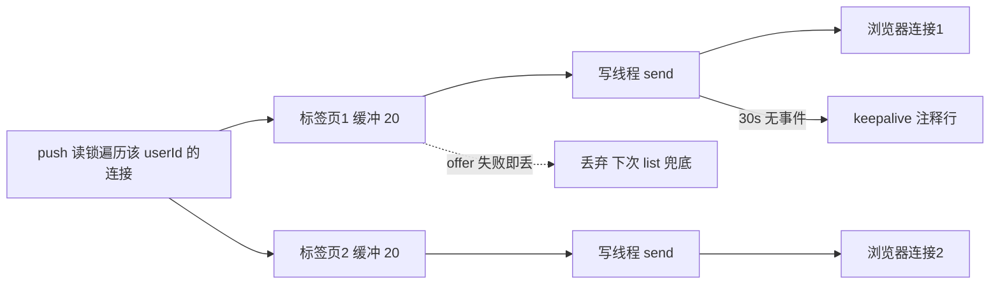

# 阶段 8 · Redis 缓存与 SSE 实时通知

> **本阶段做什么**：实现站内通知（SSE 实时推送 + 列表 / 已读 / 未读数）和私信；
> 再把前 7 个阶段散落的缓存行为收口成一张地图，做一次跨实现的缓存兼容验证。
> **做完能演示**：B 的浏览器不刷新就看到"A 赞了你"；红点、已读、私信会话页可用；缓存地图逐项打勾。
> **开工前确认**：Kafka 与 MySQL 在跑（第 1 步要建 `messages` 表）；《07》第 2 步表格里声明的消费者组
> `cg-notification` 已声明但还没接消费。只要《07》第 6 步把 `auto.offset.reset=earliest` 配上了，
> 前面阶段发出去、这条组还没读过的存量消息就会在你接上消费者时一次性涌进来，正好当本阶段的测试数据；
> 没配 earliest 的话新组从"现在"开始读，**存量读不到**，改用自己现场造事件即可（两种都能验收，别等积压）。
> **预计用时**：2-3 天。

一句架构事实，本阶段后面所有决定都由它派生：参考实现把**通知消费者 + 内存 Hub + 推送**全放在 API 进程里——
SSE 连接存在谁的内存里，推送就只能由谁发出。
SSE（Server-Sent Events）是浏览器原生的"服务端单向长连接推送"，本质是一个永不结束的 HTTP 响应。

---

## 第 1 步 · 建 messages 表，并确认前九张都在

```bash
cd deploy && docker compose exec -it mysql mysql -uroot -p123456 feedsystem
```

粘贴执行（与原版 GORM 建出来的结构逐字一致，这样两边可以共用同一个库）：

```sql
CREATE TABLE `messages` (
  `id` bigint unsigned NOT NULL AUTO_INCREMENT,
  `from_id` bigint unsigned NOT NULL,
  `to_id` bigint unsigned NOT NULL,
  `content` text NOT NULL,
  `is_read` tinyint(1) DEFAULT '0',
  `created_at` datetime(3) DEFAULT NULL,
  PRIMARY KEY (`id`),
  KEY `idx_message_from` (`from_id`),
  KEY `idx_message_to` (`to_id`)
) ENGINE=InnoDB DEFAULT CHARSET=utf8mb4 COLLATE=utf8mb4_0900_ai_ci;
```

`notifications` 不在这里建——它已经在《05》第 1 步建好了，因为那阶段的 @ 提及就要往它插行。

`SHOW TABLES;` 先数一遍，此时应当已有 9 张：`accounts`、`videos`、`tags`、`video_tags`、`outbox_msgs`、
`comments`、`likes`、`notifications`、`socials`；加上刚建的 `messages` 共 10 张。少一张说明前面阶段跳了步。

通知实体（`/stream` 的 `data` 帧与 `/list` 的元素都是这个结构）：

```jsonc
{"id":1, "recipient_id":2, "sender_id":3, "type":"like|comment|follow|mention",
 "target_id":<视频 id；follow 时是粉丝 id>, "content":"点赞了你的视频",
 "is_read":false, "created_at":"RFC3339"}
```

四类通知的文案与 `target_id` 逐字如下，消费者第 6 步会用到：

| type | content（逐字） | target_id |
|------|-----------------|-----------|
| `like` | `点赞了你的视频` | 被赞视频 id |
| `comment` | `评论了你的视频` | 被评论视频 id |
| `follow` | `关注了你` | **粉丝自己的 id**（follower_id） |
| `mention` | `"<评论人用户名> 在评论中提到了你"` | 评论所属视频 id |

**通过标志**：`SHOW TABLES` 十张齐全；`SELECT COUNT(*) FROM notifications;` 能查（表在《05》就建好了）。

## 第 2 步 · 先做私信：全项目最简单的一域

为什么先做它：一张表、两个接口、无缓存、无实时推送，拿来验证"阶段 3 的鉴权拦截器 + 阶段 5 之后
的写库套路"还活着，再动通知那种长连接东西。

| 端点 | 请求 | 响应与校验 |
|------|------|------------|
| `POST /message/send` | `{to_id, content}` | 200 返回 **Message 实体本身**（`{id,from_id,to_id,content,is_read,created_at}`）；`to_id=0` 或 content trim 后为空 → 400 `to_id and content are required` |
| `POST /message/list` | `{peer_id}` | `{"messages":[...]}`，条件 `(我→他) OR (他→我)`，`created_at DESC LIMIT 50`，空为 `[]`；`peer_id` 为 0 → **400** `peer_id is required` |

两条既定事实照抄：**不校验收件人是否存在**（发给不存在的 id 也返回 200，写进差异清单）；
`from_id` 只信登录态，不信请求体。

```bash
curl -s --noproxy '*' -XPOST localhost:8081/message/send -H "Authorization: Bearer $A" \
  -H 'Content-Type: application/json' -d '{"to_id":2,"content":"hello"}'
curl -s --noproxy '*' -XPOST localhost:8081/message/list -H "Authorization: Bearer $B" \
  -H 'Content-Type: application/json' -d '{"peer_id":1}'
```

**通过标志**：send 返回带 `id` 的实体；list 能看到这条；打一个没聊过的人返回 `{"messages":[]}` 而不是 null。

## 第 3 步 · 通知读端三接口（还没有生产者，先手工造数据）

```sql
INSERT INTO notifications (recipient_id, sender_id, type, target_id, content, created_at)
VALUES (1, 2, 'like', 1, '点赞了你的视频', NOW(3));
```

| 端点 | 请求 | 响应 |
|------|------|------|
| `POST /notification/list` | `{}` | `{"notifications": [...]}`，本人收件、`created_at DESC LIMIT 50`、空为 `[]` |
| `POST /notification/markRead` | `{id}` 或空 body / `{}` | 传 id 标单条，省略则标全部；`{"message":"ok"}` |
| `POST /notification/unreadCount` | `{}` | `{"count": n}`——响应字段名逐字 `count` |

三个读接口若从上下文取不到 accountID → **401** `invalid account`（原版 `worker/ssehub.go` 里三处都是这一句）。

`markRead` 标单条时 `WHERE id = ? AND recipient_id = ?`——只能标自己收件箱里的。
空 body 要宽容：`@RequestBody(required = false)`（参考实现把空 body 视为"标全部"）。

**通过标志**：三条 curl 依次返回带刚插入通知的列表 → `{"message":"ok"}` → `{"count":0}`。

## 第 4 步 · SSE 用的鉴权与一个安全决策点

SSE 组单独一个拦截器：token **先取查询参数 `?token=`**，取不到再看 `Authorization: Bearer`。
原因很实际——浏览器的 `EventSource` 不能设自定义请求头，只能塞进 URL。
鉴权失败响应体逐字：401 `{"error":"missing token"}`（没带 token）/ 401 `{"error":"invalid token"}`（验签或过期失败）。

> **警告（安全事实，要自己决策）**：参考实现的 SSE 校验**只做 JWT 验签与过期判断**，
> **不查《03》的 token 白名单**（不比对 `v1:account:{id}` 当前值）。
> 后果：登出时被"撤销"的 access token，在自然过期（**15 分钟**）前**仍可访问通知与 SSE**（这一族只验签）。
> 别把这句话扩大到私信：`/message/*` 挂的是《03》那套**带白名单比对**的硬鉴权，登出后立刻 401 `token has been revoked`。
> 决策点：a) 严格照抄（差分测试友好）；b) 加上白名单校验（更安全）。
> **推荐 b)**，并把"通知类 401 行为两版预期不同"记进差异清单。

**通过标志**：无 token 连 `/notification/stream` → 401 `missing token`；乱 token → 401 `invalid token`。

## 第 5 步 · SseHub 与 `/notification/stream`

六条语义（Hub 的全部行为契约）：

- 按 userId 组织连接：**一个用户多条连接**（多标签页各算一条）。
- 每条连接一个容量 **20** 的有界缓冲；投递非阻塞，**满则丢弃不阻塞**——慢客户端不拖累服务端，靠下次 `/list` 兜底。
- 断线即摘除，不留死连接；**无重连游标、无 ACK**：断线期间的通知不补发，fire-and-forget。
- 空闲 30 s 发一行注释 `: keepalive\n\n`（防代理掐闲置连接）。
- 通知落库**没有幂等键**：重复投递会产生重复通知（与《07》第 7 步 comment 弱点同源）。

Java 版用"每连接一个有界缓冲 + 一个专职写线程"实现同一套语义：

```java
@Component
public class SseHub {
    private final Map<Long, List<Client>> clients;     // 读多写少，配读写锁
    record Client(SseEmitter emitter, PendingBuffer pending, Thread writer) {}
    // PendingBuffer：容量 20 的有界缓冲，offer() 非阻塞、满了就丢
    public SseEmitter subscribe(long userId) {
        // new SseEmitter(0L) → 建容量 20 缓冲 → 挂进 map → 起写线程：
        //   循环 poll(30 秒)：取到就 emitter.send(JSON)，取不到就发注释 keepalive
        // emitter.onCompletion / onTimeout / IO 异常 → 从 map 摘除 + 中断写线程
    }

    public void push(long userId, Notification n) {
        // 读锁遍历该 userId 的所有连接：pending.offer(n) 返回 false 就丢，绝不阻塞
    }
}
```



端点契约：`GET /notification/stream` → `Content-Type: text/event-stream`，每个事件
`data: <Notification JSON>\n\n`。`spring-boot-starter-webmvc` 自带 `SseEmitter`，**本阶段无需新依赖**。

两条必踩的坑，现在一起处理：

1. `SseEmitter` 构造**必须显式传 0**——不传超时值时默认约 **30 秒**就断流，`0` 才是永不为空闲超时。
2. yml 里兜底一层（**并进已有的 `spring:` 块**，别出现两个顶层 `spring:`；已对照官方文档核实，2026-09-03）：

```yaml
spring:
  mvc:
    async:
      request-timeout: -1      # -1 = 不超时
```

> 说明：如果你加了压缩过滤器或反向代理，确认 `/notification/stream` **不缓冲**
> （可对照原版 `frontend/nginx.conf` 给 `/static/` 关闭 buffering 的写法）。自行攒包的 Filter 是首号嫌疑人。

**通过标志**：`curl -sN "http://localhost:8081/notification/stream?token=$B"` 挂住不断，
什么都不做时 35 秒内看到一行 `: keepalive`；`Ctrl-C` 后服务端日志显示该连接被摘除。

## 第 6 步 · 接上 cg-notification：让通知真的产生

消费者处理每条消息只有五步（`NotificationConsumer` 复用《07》第 6 步的 `AbstractConsumer`）：

1. 按 action 过滤：只处理 `like` / `publish` / `follow`，unlike、delete、unfollow 不产生通知。
2. 关键字段为 0 就跳过，而且**三类事件看的字段不一样**（照抄原版 `notificationworker.go`）：like 查 `user_id`/`video_id`、comment 查 `author_id`/`video_id`、follow 查 `follower_id`/`vlogger_id`。
3. 查 `videos` 取 `author_id` 作为收件人（follow 不查库，收件人 = `vlogger_id`）。
4. **操作者 = 作者则跳过**（自己赞自己不发通知）；作者为 0（视频已删）同样跳过。
5. `INSERT notifications` → `hub.push(收件人, 通知)`。

三个消费者（like / comment / social）装配在 **`ApiApplication`** 里，随 API 进程起守护线程——
理由就是开头那句：推送只能由持有连接的进程发出。Kafka 或 MySQL 任一不可用 → 整体不启用并打日志。
消费语义与《07》一致：poll → 处理 → 全部成功后 commit。落库与推送分离：**推送失败不影响 commit**；
DB 写失败重试三次后转 `<topic>.dlq`。

```text
A 点赞 → API 发布 like-events → cg-notification（API 进程内）→ 查作者 / 本人则跳过
       → INSERT notifications → Hub.push(作者) → 作者在线则收到 data 帧
```

> 说明：`mention` 不在这条链路上——评论服务同步直写 DB（《05》的 @ 解析与直写），
> 不经 Kafka、不推 SSE，在线用户要下次打开列表才看到。设计不统一是既定事实，照抄。

**通过标志**：A 赞 B 的视频 → 3 秒内 B 的流上出现 `data: {"type":"like",...}`；
A 赞自己的视频 → 不产生任何通知；把 Worker 进程（落库组 `cg-video-write`）杀掉再点赞 →
`cg-notification` 照样消费到，两组各自独立推进进度（《07》第 2 步表格里的扇出）。

## 第 7 步 · 缓存地图收口

抄一份到 `docs/cache-map.md`，**逐项实测**后打勾。左列全是前 7 个阶段的既定事实：

| key | 写方 | 失效方 | TTL | 验证动作 |
|-----|------|--------|-----|----------|
| `v1:account:{id}` | 登录 / 刷新 / 改名 | 登出 / 改密 / 再登录 | 24 h | 《03》已做 |
| `v1:video:detail:id={id}` | getDetail miss | 删除视频 / 热度变更 | **5 min**（锁 **2 s**） | 点赞后立刻查：key 应已消失 |
| `v1:video:entity:{id}` | Feed L3 异步回写 | 热度变更 | **1 h** | 同上 |
| `v1:feed:global_timeline` | timeline 消费者 / 冷重建 | 只裁剪不失效 | 永久，裁剪留最新 **1000** | 《07》已做 |
| `v1:feed:listByFollowing:*` | 整页 miss 回填 | 关注变更 SCAN | **24 h**（锁 **500 ms**） | 《06》已做 |
| `v1:hot:video:1m:*` | ZINCRBY | 靠 TTL 滚出 | **2 h** | — |
| `v1:hot:video:merge:1m:*` | ZUNIONSTORE 快照 | TTL | **2 min** | — |
| `v1:chunk_upload*` | init | complete | **24 h** | 《04》已做 |
| `feedsystem:ratelimit:*` | 每请求 INCR | 窗口到期 | 窗口长度 | **全项目唯一没有 `v1:` 前缀的键**（《09》） |

**通过标志**：`FLUSHDB` 之后通知与私信仍全部可用（本域不依赖缓存）；点一次赞，detail 与 entity 两键同时消失。

## 第 8 步 · 与参考实现的互通验证

前提：你按《00》第 6 节把原版跑在 8080，两边连**同一个** MySQL 与 Redis。三条都做完，
说明你的缓存序列化与原版真正兼容：

- [ ] `SharedCacheCompatTest`：Java 写 `v1:video:detail:*` → 参考实现读出，反向再跑一次，两边响应一致且无解码错误。
- [ ] `listByFollowing` 页缓存 value（内含游标与 `is_liked`）双向互读。
- [ ] 混合部署剧本（验证的是架构事实，不是 bug）：B 的 SSE 连 8081，A 用参考实现（8080）点赞 →
      B **收不到实时推送**，但 `/list` 里能看到。把这条写进 README：SSE 只推本进程连接（多实例方案见《09》进阶）。

## 本阶段验收清单

双浏览器 / 双账号剧本（B 连 SSE，A 制造事件）：

```bash
B=""   # 粘贴用户 B 登录拿到的 token
A=""   # 粘贴用户 A 登录拿到的 token
curl -sN --noproxy '*' "http://localhost:8081/notification/stream?token=$B" &     # 挂住
curl -s --noproxy '*' -XPOST :8081/like/like -H "Authorization: Bearer $A" -H 'Content-Type: application/json' -d '{"video_id":1}'
# 期望 3 s 内输出一条 data: {"type":"like",...}；挂 35 s 无事件则收到 ": keepalive"
curl -s --noproxy '*' -XPOST :8081/social/follow   -H "Authorization: Bearer $A" -d '{"vlogger_id":2}' -H 'Content-Type: application/json'
curl -s --noproxy '*' -XPOST :8081/comment/publish -H "Authorization: Bearer $A" -d '{"video_id":<B视频>,"content":"hi @用户名A"}' -H 'Content-Type: application/json'
# 流上应再出现 follow；mention 只进 /list 不实时推（第 6 步事实）
curl -s --noproxy '*' -XPOST :8081/notification/unreadCount -H "Authorization: Bearer $B" -d '{}'   # {"count":...}
curl -s --noproxy '*' -XPOST :8081/notification/markRead    -H "Authorization: Bearer $B" -d '{}'   # {"message":"ok"} → 再查 count 归 0
curl -s --noproxy '*' -XPOST :8081/message/send -H "Authorization: Bearer $A" -d '{"to_id":2,"content":"hello"}' -H 'Content-Type: application/json'
```

- [ ] 无 token → 401 `missing token`；乱 token → 401 `invalid token`。
- [ ] `markRead` 空 body 与 `{}` 两种都返回 `{"message":"ok"}` 且未读数归 0。
- [ ] 私信 list 打一个没聊过的人 → `{"messages":[]}`，不是 null。
- [ ] 两个标签页连同一 userId，两条连接都收到同一事件；kill 掉一个 curl，日志显示该连接被摘除。
- [ ] 缓存地图（第 7 步）逐项打勾。
- [ ] 序列化契约三条：Jackson 注册 `JavaTimeModule` 且输出 **ISO-8601**；Redis 值一律用
      `StringRedisTemplate` 写**裸 JSON**；时间字段用 `OffsetDateTime` 接 RFC3339（带偏移，不做时区归一）。

## 卡住了看这里

**`curl -sN` 挂着，但事件延迟十几秒才到。**
原因：某层缓冲没关（反向代理 / 压缩过滤器 / 自行攒包的 ResponseWrapper）。
处理：直连 8081 复测；看 `: keepalive` 是否按时到——能区分"网络缓冲"与"消费慢"。

**连接约 30 秒就断。**
原因：用了 `new SseEmitter()` 默认构造。
处理：显式 `new SseEmitter(0L)`，再配 `spring.mvc.async.request-timeout: -1` 兜底。

**通知重复出现。**
原因：通知落库无幂等键（第 5 步语义），且旧 API 进程没退干净、多个消费者同时在线。
处理：先数消费者进程；幂等弱点记进差异清单，与《07》的 comment 弱点一并解决（event_id 去重）。

**`markRead` 用 Postman 发 `{}` 正常、发空 body 报 400。**
原因：Spring 的 `@RequestBody` 默认 required=true。
处理：`@RequestBody(required = false)`——参考实现对空 body 是宽容的（视为标全部）。

**互读 detail 缓存时抛 `DateTimeParseException`。**
原因：参考实现写的时间带 `+08:00` 偏移，Java 侧字段用了 `LocalDateTime`。
处理：统一 `OffsetDateTime` + `JavaTimeModule`；这是共享缓存契约的一部分，全项目排查一遍。

**前端指向 8081 后收不到任何推送。**
原因：SSE 的 URL 仍拼着 8080（store 里的 base 没跟着换）。
处理：grep 前端 `notification/stream` 的拼接处，或干脆改用完整 URL 的 env 变量。
