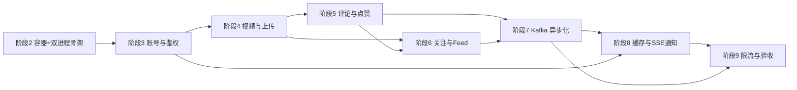

# 重建：Java / Spring Boot 短视频 Feed 系统

用 Java 从零实现一个短视频 Feed 系统（用户、视频、点赞、评论、关注、推荐流、热榜、实时通知、私信）。
这是你的第一个完整后端项目：**主线只谈 Java 怎么做**，不要求先学 Go。

## 1. 这套文档怎么用（先读这段）

四条写法约定，也是给你的阅读约定：

1. **线性步骤**：每份阶段文档就是一串"第 N 步"。每步只讲三件事——为什么做、写什么、怎么验，末尾有**通过标志**。
2. **不默认你做过任何事**。要用到容器、表、某个类、某条配置时，那一步会给出建它的命令或指向"《02》第 N 步已完成"。
3. **配置出现在用到它的那一步**。所以 `application.yml` 是从《02》到《09》一段一段长起来的，不是一开始就抄一大坨。
4. **看到通过标志再往下走**。没出现预期输出就停下解决，否则后面每一步都建立在假前提上。

## 2. 技术栈与依赖容器

| 层 | 选型 | 什么时候装 |
|----|------|-----------|
| 语言 / 构建 | Java 21 / Maven | 工程已生成（《02》第 1 步只做体检）；`./mvnw` 自带，无需装 Maven |
| 框架 | Spring Boot 4.0.8 + MyBatis-Plus 3.5.17 | 用 `mybatis-plus-spring-boot4-starter` |
| 数据库 | MySQL 8.0 | 《02》第 2 步，Docker，宿主端口 **3307**，库名 `feedsystem` |
| 缓存 | Redis 7 | 《02》第 2 步，Docker，密码 123456 |
| 消息队列 | **Kafka（KRaft 单节点）** | 《07》第 1 步追加进同一份 compose；替代原版的 RabbitMQ |
| 表结构 | 你自己手工建，共 10 张 | 每个阶段的第 1 步给出该阶段用到的 DDL（MyBatis-Plus 不会自动建表） |
| 前端 | Vue 3（原版自带，不改动） | 《09》第 9 步做联调切换 |

依赖容器归 Java 项目自己管：`feed-java/deploy/docker-compose.yml`。原版仓库那份端口相同，
两份不能同时跑（细节见《00》第 6 节，那是选修内容）。

## 3. 主线路线

| 阶段 | 文档 | 交付物 | 本阶段建哪些表 | 预计 |
|------|------|--------|----------------|------|
| 2 | 《02-环境与工程骨架》 | 依赖容器在跑、配置生效、双进程骨架 + 健康检查 | 无 | 1 天 |
| 3 | 《03-账号与JWT鉴权》 | 注册/登录/令牌刷新/登出，全站鉴权拦截 | `accounts` | 2 天 |
| 4 | 《04-视频与分块上传》 | 视频上传、分块断点续传、发布、详情缓存 | `videos`、`tags`、`video_tags`、`outbox_msgs` | 2-3 天 |
| 5 | 《05-评论与点赞》 | 评论（含 @ 提及）与点赞，同步版 | `comments`、`likes`、`notifications` | 1-2 天 |
| 6 | 《06-关注与Feed时间线》 | 关注关系与五种视频流 | `socials` | 2-3 天 |
| 7 | 《07-Kafka异步化》 | 消息队列接替同步写库，broker 宕机自动降级 | 无 | 3 天 |
| 8 | 《08-Redis缓存与SSE通知》 | 实时通知、私信、缓存一致性收口 | `messages` | 2-3 天 |
| 9 | 《09-限流与收尾验收》 | 限流、全接口自测、压测、打磨交付 | 无 | 1-2 天 |

> 系统的行为规格（接口形态、表结构、缓存 key、消息语义）在各阶段文档里直接给出，
> 照着实现即可，不需要先读 Go 源码。

各阶段之间是**真依赖**，不是编排顺序——箭头表示"后面这一步要用到前面留下的东西"：

具体到"谁用了谁"：阶段 3 的拦截器是 4/5/6/8 所有需要登录接口的前提；
阶段 4 的视频详情缓存与热度封装被 5/6/8 反复复用；阶段 5/6 留的 Noop 发布器到阶段 7 换成真的；
阶段 7 声明的 `cg-notification` 到阶段 8 才接上；阶段 9 只是把前面散落的规则收口成一张网。
跳阶段一定会卡住——这不是吓你，是因为后面的文档默认前面那些东西**真的在**。

### 选修资料（不在主线里，别在主线阶段啃它们）

> 编号说明：这套文档没有《10》，《11》就是附录，找不到《10》不是丢了文件。

| 文档 | 内容 | 什么时候看 |
|------|------|-----------|
| 《01-给Java同学的Go速读课》 | Go 语言点速成 | 想读原版代码时 |
| 《11-附录：Go原版速查与移植对照》 | 语法对照表 + 原版文件导航 | 查规格出处时 |
| 《00-项目全景与源码导览》 | 原版系统全貌（RabbitMQ 口径）+ 怎么跑起原版 | 想跑差异测试时 |

## 4. 术语表

| 术语 | 含义 |
|------|------|
| 接口（endpoint） | 一个 HTTP 方法与路径，如 `POST /account/login` |
| JWT | 登录凭证；HS256 签名，15 分钟有效 |
| token 白名单 | 服务端记录的"当前唯一有效 token"，不符即拒绝；同账号重复登录互踢 |
| 游标分页 | 用"上一页最后一条的位置"代替页码的分页方式 |
| RFC 3339 | 一种带时区偏移的时间文本格式，如 `2026-09-03T20:15:00+08:00`；原版的 JSON 时间字段就是它，所以 Java 侧要用 `OffsetDateTime` 而不是 `LocalDateTime` |
| bcrypt | 密码哈希算法；`$2a$10$` 前缀里的 10 是代价因子（越大越慢），原版固定 10 |
| Lua 脚本 | 交给 Redis 原子执行的一小段脚本，用来把"计数 + 设过期"合成一次往返（《09》第 2 步） |
| ZSET | Redis 有序集合，用来做时间线窗口和热榜 |
| topic / 分区 / 消费者组 | Kafka 的发布订阅单元 / 并行度单位 / 同组分摊消费 |
| Outbox（本地消息表） | 业务数据与待投递消息同一事务写库，后台任务投递，保证不丢 |
| SSE | 服务器单向实时推送的 HTTP 长连接 |
| 降级 | 依赖不可用时退回更简单但正确的路径（如 MQ 挂了就打库） |
| DDL | 建表语句；本项目由你在每个阶段第 1 步手工执行 |

## 5. 现在开始

打开《02-环境与工程骨架》，从**第 0 步 工程本体**开始：先核对 `pom.xml` 里的依赖，
再第 1 步体检（`java -version` / `./mvnw -v` / `docker info`），第 2 步起你自己的依赖容器。
遇到任何一步没出现"通过标志"，把那一步的报错原文发我。
