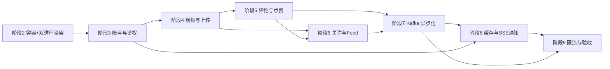

# 重建：Java / Spring Boot 短视频 Feed 系统

用 Java 从零实现一个短视频 Feed 系统（用户、视频、点赞、评论、关注、推荐流、热榜、实时通知、私信）。
这是你的第一个完整后端项目：**主线只谈 Java 怎么做**，不要求先学 Go。

## 1. 这套文档怎么用（先读这段）

> **当前仓库状态（2026-09）**：阶段 2 骨架、阶段 3 账号与 JWT（注册/登录/刷新/登出/改名/改密/资料/头像上传 + 全站鉴权 + 契约测试）已完成并通过验收；阶段 4—9 的业务实现仍按路线逐步完成。
> 因此，后续文档中的“新建”“已有类”和“通过标志”分别表示目标步骤、前置步骤产物和该阶段完成后的验收条件，不能当作当前仓库已经实现。
>
> 文档中的 `123456`、`password123` 仅用于本机学习环境。不要把这些凭据用于共享网络、生产环境或提交到真实部署配置。

四条写法约定，也是给你的阅读约定：

1. **线性步骤**：每份阶段文档就是一串"第 N 步"。每步只讲三件事——为什么做、写什么、怎么验，末尾有**通过标志**。
2. **不默认你做过任何事**。要用到容器、表、某个类、某条配置时，那一步会给出建它的命令或指向"《02》第 N 步已完成"。
3. **配置出现在用到它的那一步**。所以 `application.yml` 是从《02》到《09》一段一段长起来的，不是一开始就抄一大坨。
4. **看到通过标志再往下走**。没出现预期输出就停下解决，否则后面每一步都建立在假前提上。

## 1.5 AI 协作模板：每步输出结构

当用户说"下一步 / 下一节 / 继续"时，AI 按固定结构组织输出（核心四段 + 两个可选项）。内容同时遵从上文的阅读约定，并遵守 `.ai/WORKING.md` §2 的关键约定（先知识点后代码、写入前确认、命令与 nvim 快捷键成对给出、不弹提问框）。

1. **目的**（对照文档该步的"做完能演示"）：这一步完成什么、解决什么问题，一句话说完。
2. **知识点**：先讲清背后的原理/为什么这么设计（对应《01》的"心智模型"），再讲要用到的库/API/概念，最后落到文档这一步的契约细节。别直接铺代码。
3. **代码**：每段代码前点一句它对应哪条契约/哪个知识点；标注文件路径；复杂做法给"为什么"。
4. **验收**（对应文档的"通过标志"）：给可复制的 curl/命令，附期望输出原文；同时给出 nvim 快捷键。**命令必须自包含（2026-09-25 起）**：不许在可复制块里留下要手填的占位符（如 `<A的id>`）——它会被原样粘贴、查出"键不存在"这类假故障。做法二选一：用变量拼（`AID=$(...); KEY="...accountID=${AID}:..."`），或写成脚本文件让用户直接 `bash /tmp/xxx.sh`；确实需要替换的，单独一行醒目提示"把 X 换成你的 Y"。
5. **测试说明**（2026-09-24 起）：测试代码**照常给出**（AI 写、用户审阅）；额外要求在测试代码前用 3~5 行讲清"**测什么、怎么测**"——覆盖哪几条契约、数据怎么造（几条、什么特征）、断言什么（尤其是能抓住回归的那条）。不贴语法解释、不复述代码。

可选项：
- **前置检查**：如果该步依赖容器、表、已有类或前一步产物，先列出"开工前确认"（钉死假设，避免在假前提上写代码）。
- **变更记录**：涉及状态码/文案/错误契约斟酌、或记入 README「4. 差异说明」的内容，放在代码后明确点出。

## 2. 技术栈与依赖容器

| 层 | 选型 | 什么时候装 |
|----|------|-----------|
| 语言 / 构建 | Java 21 / Maven | 工程已生成（《02》第 1 步只做体检）；`./mvnw` 自带，无需装 Maven |
| 框架 | Spring Boot 4.0.8 + MyBatis-Plus 3.5.17 | 用 `mybatis-plus-spring-boot4-starter` |
| 数据库 | MySQL 8.0 | 《02》第 2 步，Docker，宿主端口 **3307**，库名 `feedsystem` |
| 缓存 | Redis 7 | 《02》第 2 步，Docker，密码 123456 |
| 消息队列 | **Kafka（KRaft 单节点）** | 《07》第 1 步追加进同一份 compose；替代原版的 RabbitMQ |
| 表结构 | 你自己手工建，共 10 张 | 每个阶段的第 1 步给出该阶段用到的 DDL（MyBatis-Plus 不会自动建表） |
| 前端 | Vue 3（原版自带，不改动） | 《09》第 9 步做联调切换 |

依赖容器归 Java 项目自己管：`feed-java/deploy/docker-compose.yml`。原版仓库那份端口相同，
两份不能同时跑（细节见《00》第 6 节，那是选修内容）。

## 3. 主线路线

| 阶段 | 文档 | 交付物 | 本阶段建哪些表 | 预计 |
|------|------|--------|----------------|------|
| 2 | 《02-环境与工程骨架》 | 依赖容器在跑、配置生效、双进程骨架 + 健康检查 | 无 | 1 天 |
| 3 | 《03-账号与JWT鉴权》 | 注册/登录/令牌刷新/登出，全站鉴权拦截 | `accounts` | 2 天 |
| 4 | 《04-视频与分块上传》 | 视频上传、分块断点续传、发布、详情缓存 | `videos`、`tags`、`video_tags`、`outbox_msgs` | 2-3 天 |
| 5 | 《05-评论与点赞》 | 评论（含 @ 提及）与点赞，同步版 | `comments`、`likes`、`notifications` | 1-2 天 |
| 6 | 《06-关注与Feed时间线》 | 关注关系与五种视频流 | `socials` | 2-3 天 |
| 7 | 《07-Kafka异步化》 | 消息队列接替同步写库，broker 宕机自动降级 | 无 | 3 天 |
| 8 | 《08-Redis缓存与SSE通知》 | 实时通知、私信、缓存一致性收口 | `messages` | 2-3 天 |
| 9 | 《09-限流与收尾验收》 | 限流、全接口自测、压测、打磨交付 | 无 | 1-2 天 |

> 系统的行为规格（接口形态、表结构、缓存 key、消息语义）在各阶段文档里直接给出，
> 照着实现即可，不需要先读 Go 源码。

各阶段之间是**真依赖**，不是编排顺序——箭头表示"后面这一步要用到前面留下的东西"：

具体到"谁用了谁"：阶段 3 的拦截器是 4/5/6/8 所有需要登录接口的前提；
阶段 4 的视频详情缓存与热度封装被 5/6/8 反复复用；阶段 5/6 留的 Noop 发布器到阶段 7 换成真的；
阶段 7 声明的 `cg-notification` 到阶段 8 才接上；阶段 9 只是把前面散落的规则收口成一张网。
跳阶段一定会卡住——这不是吓你，是因为后面的文档默认前面那些东西**真的在**。

### 选修资料（不在主线里，别在主线阶段啃它们）

> 编号说明：这套文档没有《10》，《11》就是附录，找不到《10》不是丢了文件。

| 文档 | 内容 | 什么时候看 |
|------|------|-----------|
| 《01-给Java同学的Go速读课》 | Go 语言点速成 | 想读原版代码时 |
| 《11-附录：Go原版速查与移植对照》 | 语法对照表 + 原版文件导航 | 查规格出处时 |
| 《00-项目全景与源码导览》 | 原版系统全貌（RabbitMQ 口径）+ 怎么跑起原版 | 想跑差异测试时 |

## 4. 差异说明（明确改进项，最终在《09》第 7 步收口）

- **错误状态码路线：选 B（语义修正）**——登录失败 **400** `invalid username or password`（统一文案，原版是两条不同底层错误原文）、注册重名 **409** `username already exists`；`refresh` 失败 401、`findByID`/`findByUsername` 查无 404 保持原样不动。红线遵守：登录失败不用 401。
- `updateProfile` 两字段全空 → 文档只给文案未给状态码（留白），按 **400** `nothing to update` 处理。
- `getProfile`：`account_id` 缺失或传 0 → **400** `account_id is required`（原版是路由内联校验 `router.go:149-151`）。四计数实时 COUNT/SUM，任一失败记 **0** 不报错。
- refresh 反查：缓存未命中时按 `accounts.refresh_token` 列回表反查账号并回填缓存（写库先行、缓存后写）。原版无此列查询。
- 头像上传按文档契约：multipart 字段 `file`、上限 10MB、扩展名 jpg/jpeg/png/webp（大小写不敏感）；三段校验失败各 400 文案逐字（`missing file` / `invalid file size` / `only .jpg/.jpeg/.png/.webp allowed`）；写盘异常 500 + 底层错误原文。Spring 侧将默认 1MB 上限提到 12MB（超 12MB 由 Spring 拒收，兜底映射为同一条 400）。

### 阶段 4 差异（2026-09-16）

- **未实现的死代码路由**（有意不实现）：原版 `DeleteVideo`、`UpdateLikesCount` 在 handler/service/repo 三层都有实现，但 `router.go` 里**没有注册**（已核实路由表只有 9 个 `/video` 路由）——实现它们等于新增"未授权的 API 面"，故跳过。
- **免费拿到的能力**：静态资源走 Spring 内置 `/static/**` 处理器，**原生支持 HTTP Range**（实测 `206` + `Accept-Ranges: bytes` + 100 字节分片下载），不需要手写 Range 解析。
- **我们有意改掉的行为**：
  1. 第 6 步"轮询耗尽不回填缓存"（原版会回填；避免迟到读者用旧数据覆盖持锁者刚写入的版本）。
  2. `publish` 的 `videos.username` 来源：原版从 **JWT claims** 取 `username`（`jwt.GetUsername(c)`），我们**回表查 `accounts`**（`accountMapper.selectById`）——因为本项目 JWT 只保证签发时刻的用户名，改名后回表拿到的才是当前值。
  3. chunk 族"Redis 运行中不可用"：原版 init 走 500/upload·status 走 404（因为只在启动时判 `cache == nil`）；我们统一 **503 `chunk upload requires redis`**（把 `DataAccessException` 一并归入降级）。
  4. `chunk_index` 我们设为**必填**（原版不传按 0 处理，可能静默传错片）。
  5. 上传返回的 URL 用 `X-Forwarded-Proto` + `Host` 头拼绝对地址（原版用固定配置的 base URL）。

### 阶段 6 差异（2026-09-26）

- **第 8 步 L3「按 id 批量查库」按原版实现为「每个 id 单查」**：《06》第 8 步写的是「singleflight 合并同并发 → 按 id 批量查库」，而 Go 原版 singleflight 内是 `f.repo.GetByIDs(ctx, []uint{videoID})`——**每次只传 1 个 id**（`backend/internal/feed/service.go:115`；repo 的 `WHERE id IN ?` 本身支持批量，只是调用方没批量化）。Java 侧 `FeedMapper.listByIds` 同样是 `IN` 查询，调用时传单元素 `List.of(id)`：合并单元的键与结果都是"每个 id 一个"，一个 id 的合并单元里不存在多个 id 可批。
- **第 8 步 L1 用 Caffeine（文档已声明的有意差异）**：原版是 `patrickmn/go-cache` 的 `cache.New(3s, 5s)`——无容量上限、写入 TTL 5s；Java 侧按《06》第 8 步用 Caffeine `maximumSize(2000)` + `expireAfterWrite(5s)`，**L1 键与 L2 键是同一个字符串** `v1:video:entity:{id}`，所以 `VideoCacheService.updatePopularityCache` 的 DEL 只清得到 L2，L1 的陈旧窗口由 5 秒 TTL 封顶（与原版行为一致）。
- **`create_time` 的 UTC 归一化（开发中发现，影响跨实现比对）**：Jackson 3 反序列化 `OffsetDateTime` 会把偏移归一化成 UTC——同一个时刻，Redis 里写回的是 `2026-09-25T02:30Z` 而非原样的 `2026-09-25T10:30:00+08:00`（Go 的 `time.Time.MarshalJSON` 保留自身偏移）。两边各自都是合法 RFC 3339，`toEpochSecond()` 与排序不受影响；但《06》第 11 步做 Java↔Go 双跑对比时，别拿这个字符串做逐字比对。
- **第 9 步重建递归加了"只重入一次"的上限**：原版重建时忽略 `ZAdd` 的错误（`backend/internal/feed/service.go:187`）且靠递归重入（`:199`）、没有深度上限——`ZADD` 持续失败（Redis 只读 / 内存满）会一直递归下去。Java 侧用 `allowRebuild` 旗标：第二次进来窗口仍为空就直接走 DB 兜底。正常路径与 `EMPTY_DB` 哨兵的行为完全一致。
- **第 9 步 `stitch` 失败保留"返回短页"但补了日志**：原版 `service.go:266` 把拼接查询的错误静默吞掉（用户看到 `has_more=false`，等效于"流到底了"）；我们保留这个取舍并加 `log.warn` 便于排障。
- **第 9 步"Redis 不可用就降级"的边界照原版**：只有**入口读 watermark** 失败才降级查 DB（`service.go:157-159`）；热路径 `ZREVRANGEBYSCORE` 失败原版直接返回 500、不降级（`:232-234`）。所以"停掉 Redis 仍 200"成立（入口必失败 → 走 DB 分支），但"请求进行到一半 Redis 挂了"这个竞态窗口内仍会 500。
- **第 10 步 `unionAndStore` 的第一个参数也是源**：Spring Data 的签名是 `unionAndStore(第一个源, 其余源集合, 目标)`，而原版是 `ZUnionStore(dest, keys...)`。照原版直觉写成 `unionAndStore(w0, 全部60个键, dest)` 会把 `w0` 那一分钟**算两次**（实测同一 member 15 分变成 25 分）。正确写法：`unionAndStore(windows.get(0), windows.subList(1, windows.size()), snapshot)`。
- **第 10 步快照的两套游标不同源**（文档未写明）：Redis 路径的 `next_latest_*` 取的是**最后一条 DB 实体的 `popularity` 绝对值**，而快照的排序键是"60 分钟窗口 `ZINCRBY` 增量之和"——那套三元游标只在"接下来降级到 DB"时才有用，不能指望它与快照顺序连续。
- **第 10 步"读成功但空"判定的是原始 members**（文档只写了 members 为空）：members 非空但解析失败、或那些视频已被删时，返回的是 `as_of` **非 0** 的空页且**不进 DB**（`has_more=false`，翻页就此停滞）。另外原版 `as_of <= 0` 一律当"用当前分钟"、`offset` 完全不校验（负数原样透传给 Redis）；原版给快照的 Exists/ZUnionStore/ZRevRange 设了 80ms 上下文超时，我们没设（靠 Lettuce 连接级超时），属有意省略。
- **请求体缺字段按零值处理（对齐 Go，2026-09-28）**：Jackson 3 默认开启 `FAIL_ON_NULL_FOR_PRIMITIVES`，`{"tag_name":"x"}` 这种缺 `limit` 的请求体会直接 **500**（`Cannot map null into type int`），而原版 Go 对缺字段一律按零值走（缺 `limit` → 归一成 10、缺 `as_of` → 用当前分钟、缺 `offset` → 首页）。已在 `application.yml` 关掉该开关（`spring.jackson.deserialization.fail-on-null-for-primitives: false`），五个 feed 端点的"缺字段 / 显式 null"请求实测均返回 200；这是对 `README` 里"请求体解析失败 → 500 + 原始错误原文"的**收窄**，只对真正畸形的 JSON 生效。
- **热榜降级页的翻页语义照原版（2026-09-28 前端联调确认）**：`as_of=0` 的 DB 兜底页同时返回 `next_offset=0`，而前端按 `as_of` + `next_offset` 翻页 → 降级期间点"加载更多"会重复请求第一页（`{limit, as_of:0, offset:0}`）。原版 Go 的兜底页同样返回 `as_of=0/next_offset=0`，属参考实现固有行为；有热数据时快照路径的 `as_of`/`next_offset` 正常推进（已实测：第 1 页 10 条 `next_offset=10`、第 2 页剩 2 条 `has_more=false`，不重不漏）。
- **`/account/register` 不发 token（前端联调时确认）**：返回 `{"message":"account created"}`，token 必须另调 `/account/login`（与《03》契约一致，仅作提醒——写验收脚本时别假设注册响应里有 token）。

### 阶段 7 差异（2026-09-29）

- **生产者 `acks=1` + 显式关闭幂等（对齐原版宽松语义）**：原版投递不等全副本确认；本实现把生产者钉为 `acks=1`、`enable.idempotence=false`——显式写 `false` 是把 Kafka 3.0 起"幂等默认开、与 `acks=1` 冲突时自动降级并打日志"的隐式行为变成可读配置；投递失败由调用方的同步降级事务兜底。**改进项**：更强的不丢语义 = `acks=all` + 保留幂等开关（`delivery.timeout.ms` 需相应调整），留待《09》收口时决定。

### 阶段 8 差异（2026-10-05）

- **私信不校验收件人是否存在（照抄原版）**：`POST /message/send` 的 `to_id` 指向不存在的账号也返回 200 并落库。第 8 步与 Go 版互通对照时以此为准；若要加校验属改进项，会破坏两版行为对齐。
- **通知/SSE 一族 401 行为与参考实现不同（决策 b，2026-10-06）**：参考实现对 SSE 只做 JWT 验签，被撤销的 access token 在自然过期（≤15 分钟）前仍可连流；本实现额外做《03》白名单比对（与项目其它硬鉴权一致），登出/换发后立即 401 `token has been revoked`。与 Go 版差分测试时注意这处可观察差异。
- **（架构事实，2026-10-07 混合部署实测）SSE 只推本进程连接**：B 的流挂在 Java（8081）、A 用 Go 版（8080）点赞 → B **收不到实时推送**，但 Java 侧 `/notification/list` 里看得到（通知由 Go 的 RabbitMQ worker 落库到共享 MySQL）。原因：SSE 连接存在谁的内存里，推送就只能由谁发出；跨进程只能靠共享存储（列表/轮询）兜底。多实例方案见《09》进阶。

## 5. 术语表

| 术语 | 含义 |
|------|------|
| 接口（endpoint） | 一个 HTTP 方法与路径，如 `POST /account/login` |
| JWT | 登录凭证；HS256 签名，15 分钟有效 |
| token 白名单 | 服务端记录的"当前唯一有效 token"，不符即拒绝；同账号重复登录互踢 |
| 游标分页 | 用"上一页最后一条的位置"代替页码的分页方式 |
| RFC 3339 | 一种带时区偏移的时间文本格式，如 `2026-09-03T20:15:00+08:00`；原版的 JSON 时间字段就是它，所以 Java 侧要用 `OffsetDateTime` 而不是 `LocalDateTime` |
| bcrypt | 密码哈希算法；`$2a$10$` 前缀里的 10 是代价因子（越大越慢），原版固定 10 |
| Lua 脚本 | 交给 Redis 原子执行的一小段脚本，用来把"计数 + 设过期"合成一次往返（《09》第 2 步） |
| ZSET | Redis 有序集合，用来做时间线窗口和热榜 |
| topic / 分区 / 消费者组 | Kafka 的发布订阅单元 / 并行度单位 / 同组分摊消费 |
| Outbox（本地消息表） | 业务数据与待投递消息同一事务写库，后台任务投递，保证不丢 |
| SSE | 服务器单向实时推送的 HTTP 长连接 |
| 降级 | 依赖不可用时退回更简单但正确的路径（如 MQ 挂了就打库） |
| DDL | 建表语句；本项目由你在每个阶段第 1 步手工执行 |

## 6. 现在开始

打开《02-环境与工程骨架》，从**第 0 步 工程本体**开始：先核对 `pom.xml` 里的依赖，
再第 1 步体检（`java -version` / `./mvnw -v` / `docker info`），第 2 步起你自己的依赖容器。
遇到任何一步没出现"通过标志"，把那一步的报错原文发我。
