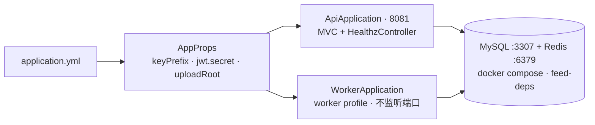
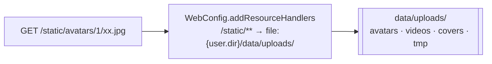

# 阶段 2 · 环境与工程骨架（✅ 已完成）

> 本阶段交付的是**地基**：能跑起来、配置能读到、依赖服务在。

## 1. 结构

- 两个启动类**共用同一份配置与容器**，区别只在 profile：`worker` profile 设了 `web-application-type=none`，所以不监听端口。
- 应用跑在**宿主进程**（`./mvnw spring-boot:run`），只有中间件在容器里。
- MySQL 刻意用 **3307**，避开宿主已有的 3306。
- Kafka 要到阶段 7 才追加进同一份 compose。

## 2. 配置

| 配置 | 值 | 说明 |
|---|---|---|
| `server.port` | `8081` | 所有验收脚本的入口 |
| `spring.datasource.url` | `jdbc:mysql://localhost:3307/feedsystem?connectionTimeZone=LOCAL&allowPublicKeyRetrieval=true&useSSL=false` | 这两个参数是必需的，多写的参数会让驱动启动失败 |
| `spring.data.redis` | `localhost:6379` 密码 `123456`，`timeout: 2s` | 2 秒超时是后面 503 判定的时间尺度 |
| `spring.servlet.multipart` | `200MB` / `210MB` | Spring 默认只有 1MB，不改的话大文件进不来 |
| `feed.redis.key-prefix` | `v1:` | 所有 Redis 键前缀（`RedisKeys.key()` 负责拼） |
| `feed.jwt.secret` | HS256 签名密钥 | 阶段 3 用 |
| `feed.upload-root` | `${user.dir}/data/uploads` | 上传根目录，`FilesTool` 消费 |

## 3. 静态资源映射

- 磁盘上的 `data/uploads/x` 通过 URL 的 `/static/x` 暴露——`FilesTool.toUrl()` 生成的就是这种 URL。
- 静态资源处理器**原生支持 Range 请求**（返回 `206` + `Content-Range`），视频能拖进度条靠它，不用自己写。

## 4. 这个地基后面被谁用

| 地基 | 用在哪 |
|---|---|
| `AppProps.redis.keyPrefix` | 阶段 3 三键、阶段 4 详情缓存与分块会话 |
| `AppProps.jwt.secret` | 阶段 3 令牌签名/验签 |
| `AppProps.uploadRoot` + `FilesTool` | 阶段 4 视频/封面/分块落盘 |
| `WebConfig` 鉴权清单 | 阶段 3 加 4 条 `/account`、阶段 4 加 7 条 `/video` |
| `/healthz` | 每次重启后的就绪探测 |
