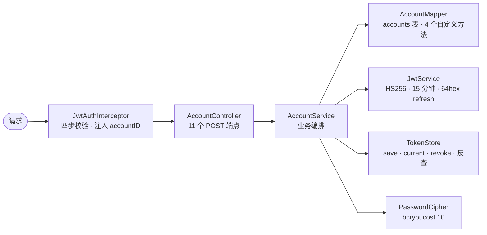
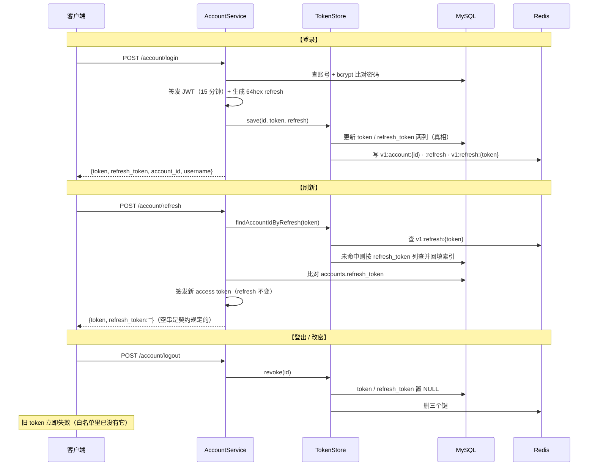
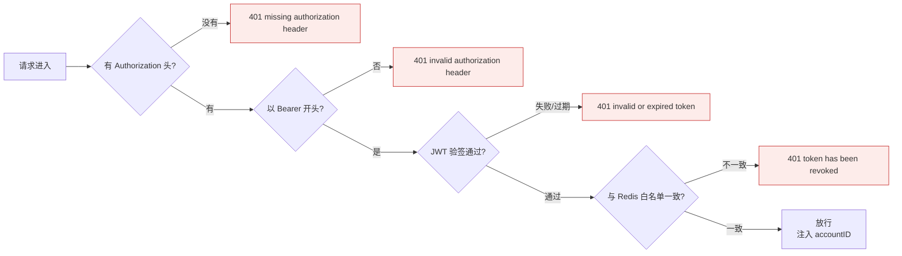
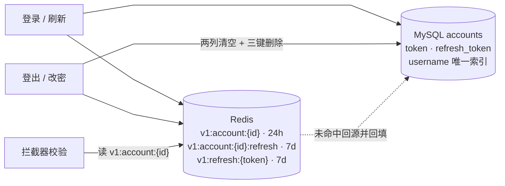

# 阶段 3 · 账号与 JWT 鉴权（✅ 已完成）

> 本册回答：**令牌怎么流转**、**每个请求怎么被验**、**11 个端点各做什么**。

## 1. 请求走向与依赖

拦截器自己也依赖 `JwtService`（验签）和 `TokenStore`（白名单），见下面第 3 节。

## 2. 令牌生命周期

## 3. 拦截器四步校验

- `Bearer ` **带尾随空格**；验签在查缓存**之前**（无效令牌不浪费 Redis 往返）。
- 第四步是双保险：验签只证明"签名对、没过期"，白名单比对才保证"没被登出/改密踢掉"。
- 注入的 `accountID` 是后续所有业务取当前用户的**唯一来源**。

## 4. 11 个端点

| 端点 | 鉴权 | 成功响应 | 失败 |
|---|---|---|---|
| `/register` | 否 | `{"message":"account created"}` | 409 重名 |
| `/login` | 否 | `{token, refresh_token, account_id, username}` | 400 统一文案 |
| `/logout` | JWT | `{"message":"account logged out"}` | 401 |
| `/refresh` | 否 | `{token, refresh_token:""}` | 401 |
| `/changePassword` | 否 | `{"message":"successfully password changed"}` | 400 |
| `/rename` | JWT | `{token}`（新签发） | 409 重名 |
| `/updateProfile` | JWT | `{"message":"profile updated"}` | 400 全空 |
| `/findByID` `findByUsername` | 否 | Account（密码类字段被 @JsonIgnore 隐藏） | 404 |
| `/getProfile` | 否 | `{account, 四个计数}` | 400 缺 id |
| `/uploadAvatar` | JWT | `{"avatar_url":"…/static/avatars/{id}/{hex}.jpg"}` | 400 |

两处易错：

- `/changePassword` **不需要 JWT**，靠"用户名 + 旧密码"自证，成功后所有旧 token 作废。
- `/rename` 在**一个事务里**同时改用户名和 token 列，成功后旧 token 立即失效。

## 5. 存储：三键 + 两列

分工：`v1:account:{id}` 给拦截器比对；`:refresh` 让 `revoke` 找到旧 refresh 去删索引；
`v1:refresh:{token}` 供 refresh 反查账号（未命中按库里的列查，命中后回填）。

## 6. 与后面的连接

| 本阶段产物 | 谁在用 |
|---|---|
| `JwtAuthInterceptor` + `accountID` 注入 | 阶段 4/5/6/8 所有需登录接口 |
| `AccountMapper.selectById` | 阶段 4 publish 时取用户名快照写入 `videos.username` |
| `accounts` 表 | 阶段 5 评论/点赞的作者、阶段 6 关注关系 |
| `getProfile` 四个计数 | 阶段 5/6 建好 `likes`/`socials` 后从不存在的表返回 0 变成真实值 |
