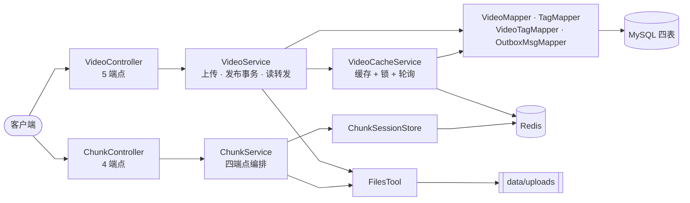
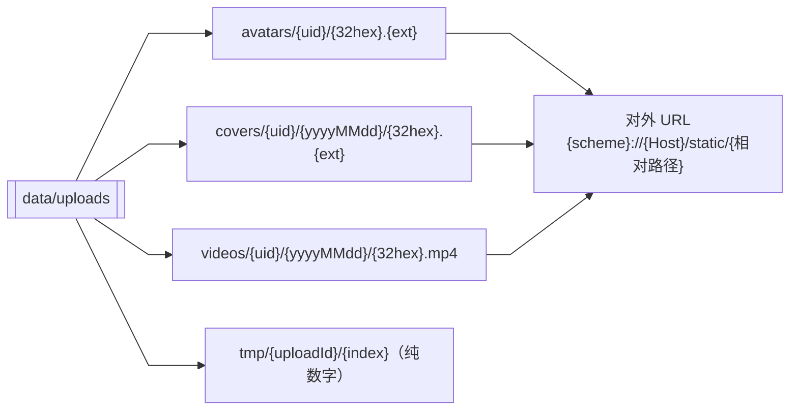
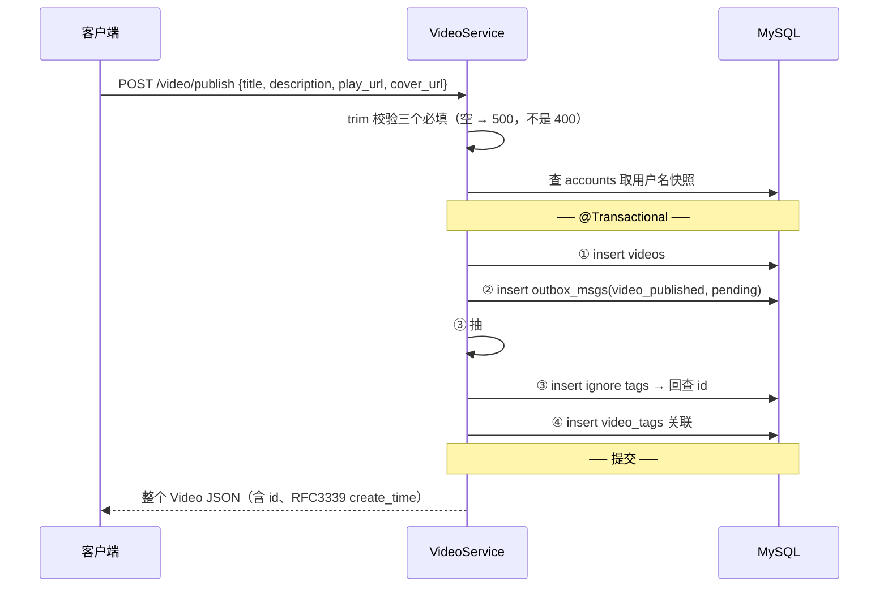
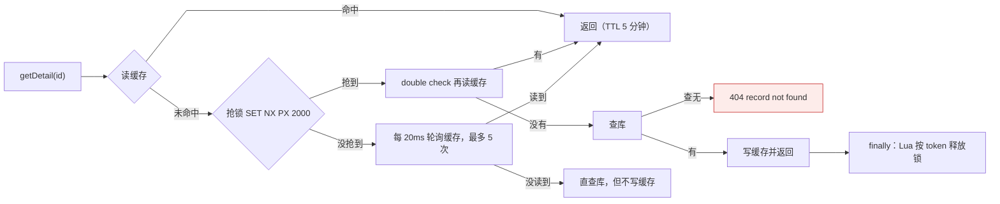
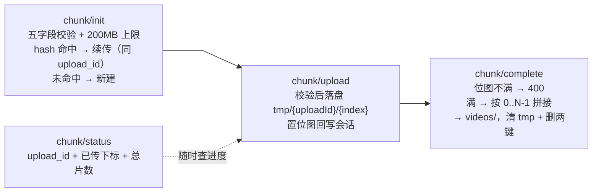
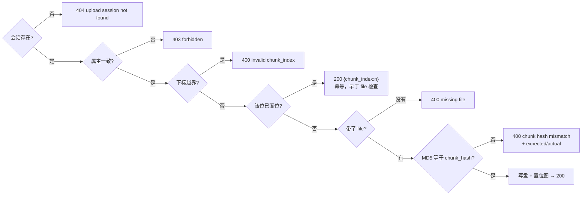
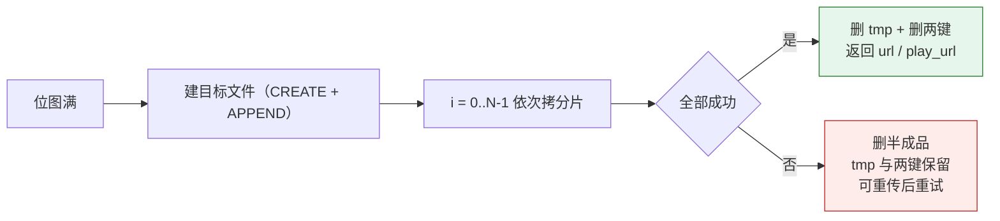

# 阶段 4 · 视频与分块上传（✅ 已完成）

> 本册回答：**视频怎么存**、**分块断点续传怎么跑**、**详情读为什么要加锁**。

## 1. 产出与模块关系

| 类别 | 内容 |
|---|---|
| 实体 | `Video` `Tag` `VideoTag` `OutboxMsg` + 四个 Mapper |
| 服务 | `VideoService`（上传+发布）· `VideoCacheService`（读缓存）· `ChunkService`（分块四端点） |
| 控制器 | `VideoController` 5 端点 · `ChunkController` 4 端点 |
| 工具 | `TagExtractor`（抽 `#话题`）· `ChunkSession`（会话）· `ChunkException`（带附加字段的错误）· `FilesTool` |
| 表 | `videos` `tags` `video_tags` `outbox_msgs` |

**鉴权分组**（`WebConfig` 逐条列，不用通配）：
需登录 = 两个上传 + publish + 四个 chunk 端点；**免登录** = `listByAuthorID`、`getDetail`（特意不加）。

## 2. 文件落盘与访问

- 文件名是 **16 字节随机 hex**（防重名、防路径穿越）；视频/封面按天分目录。
- `tmp/` 放分块临时片，合并成功后删除；`avatars`/`videos`/`covers` 带日期的是视频与封面，头像不带。
- 线上 URL 一律走 `/static/**`（阶段 2 的映射），磁盘根目录与 URL 前缀是**映射关系**不是同名关系。

## 3. 发布：一个事务四步

三个要点：

- **必填缺失是 500 不是 400**（契约如此，与账号阶段相反）。
- `description` **不做 trim**，原样入库。
- `outbox_msgs` 与视频**同事务**写（本地消息表模式）：阶段 7 的 Kafka 消费者扫 `pending` 投递后删行，现有 3 行存量就是给它准备的。
- `videos.username` 是发布时的**用户名快照**，发布时从 `accounts` 查。

## 4. 详情读：缓存 + 锁 + 轮询

| 机制 | 解决什么 |
|---|---|
| 缓存 TTL 5 分钟 | 热点视频重复读不落库 |
| 锁 TTL 2 秒 + Lua 按 token 释放 | 只让一个线程回源（防击穿）；持锁者崩溃锁自动过期；Lua 避免误删别人的锁 |
| double check | 抢锁瞬间前一个持锁者可能刚写完缓存 |
| 20ms×5 轮询 | 没抢到锁的请求等一下，能等到就不用自己查库 |
| 等不到**不回填** | 防止迟到的非持锁者覆盖持锁者刚写的版本 |
| 异常一律降级 | Redis 异常只记日志、直查库 → 缓存挂了不影响功能 |

**热度缓存 `updatePopularityCache`**：已定义、**还没有调用者**——阶段 5 的点赞第一次调用它
（删详情缓存键 + `ZINCRBY` 热度窗口键）。这是本阶段给阶段 5 留的接口。

## 5. 分块上传

### 两个 Redis 键

| 键 | 值 | 作用 |
|---|---|---|
| `v1:chunk_upload:{uploadId}` | 会话 JSON（含 `uploaded_bits` 位图） | **唯一事实来源**，进度只看它 |
| `v1:chunk_upload_hash:{uid}:{fileHash}` | 裸 uploadId（不是 JSON） | 续传索引：同一文件哈希可找回旧会话 |

都 24 小时 TTL（未完成的上传自动过期，不需要清理任务）。
选 Redis 不建表的原因：24 小时瞬时状态、位图高频小写（免行锁与事务开销）、位图即事实来源、丢了重传即可。

### 四个端点

### `upload` 的校验顺序（顺序本身就是契约）

两个反直觉点（契约如此）：

1. **幂等判断早于 file 检查**：已传过的下标重传，连 `file` 都不带也返回 200，响应体与首次上传完全一样。
2. **`expected`/`actual` 与字面相反**：`expected` = 客户端传来的 `chunk_hash`，`actual` = 服务端算出的 MD5。

### `complete` 的合并与清理

- `missing` 是**缺片个数、封顶 5**（不是缺片下标列表）：7 片全不传 → `{"missing":5,"completed":0,"total":7}`。
- 失败时保留 tmp 与两键，是为了「补传缺片后重试」——这是断点续传语义的一部分。

### Redis 是硬依赖（与详情缓存相反）

| 场景 | 行为 |
|---|---|
| 详情缓存 Redis 挂了 | **降级**：直查库、不写缓存，功能照常 |
| 分块 Redis 挂了 | **503** `chunk upload requires redis`（四端点统一） |

判定分两层：启动探活失败 → `FeatureFlags.cacheEnabled()` 为 false（四个方法第一行过 `requireCache()`）；
运行中挂掉 → `ChunkSessionStore` 捕获 `DataAccessException` → 503。

## 6. 与后面的连接

| 本阶段产物 | 谁在用 |
|---|---|
| `videos` 四个索引 + `video_tags` | 阶段 6 五种视频流（作者流、时间线、热度榜、点赞榜、话题流） |
| `outbox_msgs` 3 行 `pending` | 阶段 7 Kafka 消费者的初始数据 |
| `updatePopularityCache` | 阶段 5 点赞第一次调用（热度榜的数据源） |
| 详情缓存与锁模板 | 阶段 5/6/8 的用户信息、时间线、通知缓存都照这个模式 |
| `FilesTool` | 阶段 5 以后所有落盘与出 URL 的地方 |
