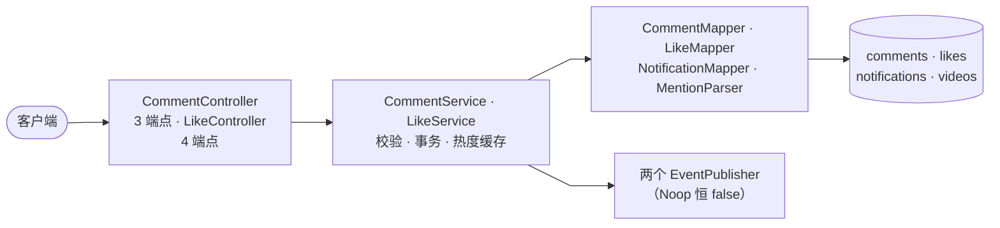
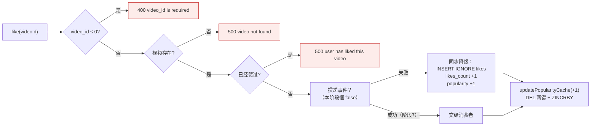
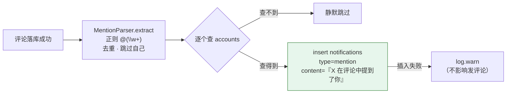

# 阶段 5 · 评论与点赞（✅ 已完成）

> 本册回答：**评论怎么读怎么写**、**点赞为什么是"看起来最简单实则最险"的一步**、**@提及怎么变成通知**。

## 1. 产出与模块关系

| 类别 | 内容 |
|---|---|
| 实体 | `Comment` `Like` `Notification` + 三个 Mapper |
| 服务 | `CommentService`（三端点 + @提及）· `LikeService`（四端点） |
| 控制器 | `CommentController` 3 端点 · `LikeController` 4 端点 |
| 工具 | `MentionParser`（抽 `@用户名`）· `LikeEventPublisher` / `CommentEventPublisher`（异步铺路，本阶段恒 false） |
| 表 | `comments` `likes` `notifications` |

| 依赖 | 用途 |
|---|---|
| `CommentService` → `CommentMapper` / `NotificationMapper` / `MentionParser` | 评论增删查、@提及写通知、解析用户名 |
| `CommentService` → `VideoMapper` / `VideoCacheService` | 视频存在性校验、热度 +1 |
| `LikeService` → `LikeMapper` / `VideoMapper` / `VideoCacheService` | 点赞行、计数、视频校验、热度 ±1 |
| 两个 Service → 各自的 `EventPublisher` | 阶段 7 的异步铺路（本阶段恒 false，走同步降级） |

**鉴权分组**：需登录 = `comment/publish` `comment/delete` + `like` 四个；
**免登录** = `comment/listAll`（只此一个，因为评论列表要能在未登录时浏览）。

## 2. 七个接口

| 端点 | 鉴权 | 请求 | 成功 | 失败路径 |
|---|---|---|---|---|
| `/comment/listAll` | 否 | `{video_id}` | 裸 Comment 数组（空为 `[]`） | `video_id` 缺失/0 → **400**；视频不存在 → **500** |
| `/comment/publish` | 是 | `{video_id, content}` | `{"message":"comment published successfully"}` | `video_id` 0 → **400**；content trim 后空 → **400**；视频不存在 → **500** |
| `/comment/delete` | 是 | `{comment_id}` | `{"message":"comment deleted successfully"}` | id 0 → **400**；不存在 → **500**；**非作者 → 401** |
| `/like/like` | 是 | `{video_id}` | `{"message":"like success"}` | id ≤0 → **400**；视频不存在 → **500**；已赞过 → **500** |
| `/like/unlike` | 是 | `{video_id}` | `{"message":"unlike success"}` | id ≤0 → **400**；视频不存在 → **500**；没赞过 → **500** |
| `/like/isLiked` | 是 | `{video_id}` | `{"is_liked":bool}` | id ≤0 → **400**；**视频不存在也返回 200 + false** |
| `/like/listMyLikedVideos` | 是 | 无（只取登录态） | 裸 Video 数组（空为 `[]`） | — |

三个反直觉点：

1. **业务校验失败是 500 不是 404**（`video not found`/`comment not found`/`user has liked this video`）——原版 service 层校验失败统一 500 的历史约定。
2. **`isLiked` 不校验视频存在**：给个不存在的 id 返回 `false`，不是 500（和写接口策略不同）。
3. **`delete` 非作者是 401**：身份问题归 401，不归"业务失败 = 500"那套。

## 3. 评论列表的读取契约

- **无缓存**，每次直查（对比阶段 4 的详情缓存：那里是热点重复读，这里要实时）。
- `ORDER BY created_at ASC LIMIT 200`，**最早的在最前**，无分页字段，超出直接截断。
- `username` 是**冗余列**：写评论时一起存，读列表免 join（代价是改名后历史评论显示旧名）。

## 4. 点赞：三条预检 + 一个事务

**这一步骤最险的地方**：预检只是**快速路径**，两个并发请求可以同时通过 `count==0` 判断。真正的防线是两件事的组合：

| 防线 | 保证什么 |
|---|---|
| `(video_id, account_id)` **唯一索引** | 只有一行能落库（第二个 INSERT 被忽略） |
| `insertIgnore` 的 **boolean 返回值** | 只有真插入的那次才加计数（返回 false → 抛 500，不加） |

少了第二个判断，"行是对的、计数是漂的"——**不报错、慢慢失真**，是最难发现的一类 bug。
unlike 一侧同理：`deleteLike` 的**影响行数**决定"减不减"，0 行说明本来没赞过。

**计数必须用 SQL 原子表达式**：`likes_count = likes_count + 1`，禁止"读出来加一再写回去"（并发下会互相覆盖）。
unlike 用 `GREATEST(likes_count - 1, 0)` 夹底，防脏数据减成负数。

## 5. @提及 → 通知

- **`\w` 只匹配 ASCII**：`@张三` 不匹配（原版 Go 的 `\w` 同样如此，行为一致，别"改好"）。
- 通知是**附属品**：插入失败只记日志，绝不能让发评论回滚（原版同款）。
- 对比阶段 4 的话题正则 `#([\p{L}\p{N}_]+)`——那个**故意**支持中文，两个正则的差异是契约要求。

## 6. 异步铺路：两个 Noop 发布器

本阶段把写路径拆成"**先投递事件 → 失败才同步落库**"，为阶段 7 的 Kafka 留形状：

| 接口 | 方法 | 本阶段行为 |
|---|---|---|
| `LikeEventPublisher` | `publishLike` / `publishUnlike` | 恒 `false`（永远走同步） |
| `CommentEventPublisher` | `publishComment(commentId, action)` | 恒 `false`；action 取 `publish`/`delete` |

两个关键设计：

1. **投递与缓存是两条独立的边**，不能合成一个开关。阶段 7 投递成功时，`likes` 行由消费者写、热度由 `PopularityConsumer` 写；如果只用一个开关，打开后会出现**双计**。
2. **`publishComment(0L, "publish")` 里的 0 是刻意的**：本阶段该参数无意义。**不能为了让参数"有意义"而先插库再投递**——那正是阶段 7 双写的来源。

## 7. 与后面的连接

| 本阶段产物 | 谁在用 |
|---|---|
| `likes` / `comments` 表 | 阶段 6 的点赞榜、话题流排序 |
| `notifications` 表 + mention 事件 | 阶段 8 的 SSE 实时推送（消息源） |
| 两个 Noop 发布器 | 阶段 7 换成 Kafka 实现（Noop 保留作降级替身） |
| 热度三件套（`updatePopularityCache`）的调用者 | 阶段 6 热度榜的数据源 |
| 并发防护模式（唯一索引 + 返回值判断 + 原子计数） | 阶段 6 关注关系（`socials` 表同款设计） |

## 8. 已知延后项

- **限流 429 未生效**：`RateLimits` 已加 `like_write`（30/分）、`comment_write`（10/分）两条规则，四个写接口也挂在限流拦截器上，但 `RateLimitInterceptor` 仍是**放行壳**——真限流在阶段 9 实现，届时「11 条评论 → 第 11 次 429」立即生效。
