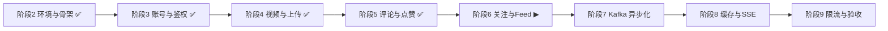
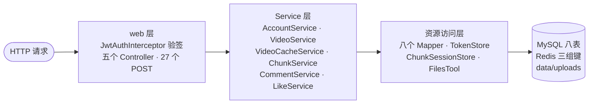

# Feed-Java · 项目全景

> 用 Java 21 + Spring Boot 4.0.8 + MyBatis-Plus + MySQL 8 + Redis 7 实现的仿抖音 Feed 系统。
> 契约以 `docs/` 各阶段文档为准。核验日期 2026-09-17。

## 1. 现状

| 项 | 现状 |
|---|---|
| 已完成 | 阶段2 环境与骨架 · 阶段3 账号与JWT · 阶段4 视频与分块上传 · 阶段5 评论与点赞 |
| 下一步 | 阶段6 关注与Feed时间线 |
| 规模 | 85 个主文件 / 3592 行；14 个测试类 / 59 个用例全绿 |
| 数据 | MySQL 8 张表、Redis 8 个键、磁盘 `data/uploads` |
| 接口 | `/account` 11 个 + `/video` 9 个 + `/comment` 3 个 + `/like` 4 个 = 27 个 POST；另有 `GET /healthz` |

## 2. 阶段路线

主干之外还有三条跨阶段依赖（画进图里会让线交叉）：阶段4→6（视频流要读 `videos` 与四个索引）、
阶段3→8（SSE 长连接复用同一套 JWT 鉴权）、阶段7→9（压测与降级验收要 Kafka 先就位）。

## 3. 分层结构

| 层 | 职责 | 谁依赖谁 |
|---|---|---|
| web | 拦截器只管鉴权；Controller 只做参数绑定与转发 | Controller → 各自的 Service；拦截器 → `JwtService` + `TokenStore` |
| Service | 业务编排与校验，事务边界在这里 | `AccountService` → Mapper + `PasswordCipher` + `JwtService` + `TokenStore`；`VideoService` → 四个视频 Mapper + `VideoCacheService` + `FilesTool`；`ChunkService` → `ChunkSessionStore` + `FilesTool` + `FeatureFlags`；`CommentService` → `CommentMapper` + `NotificationMapper` + `MentionParser` + `VideoCacheService`；`LikeService` → `LikeMapper` + `VideoMapper` + `VideoCacheService` + `LikeEventPublisher` |
| 资源 | 数据访问与外部资源封装 | Mapper → MySQL；`TokenStore`/`ChunkSessionStore`/`VideoCacheService` → Redis；`FilesTool` → 磁盘 |

规则：**不跨层调用**（Controller 不直接碰 Mapper）。

## 4. 跨阶段不变式

1. 错误响应固定 `{"error":"文案"}`，无包装层；文案逐字存在 `infra/Errors`（47 条）。
2. 鉴权双保险：JWT 验签 + Redis 白名单比对，登出/改密能立刻踢掉 token。
3. 令牌**真相在数据库**（`accounts` 两列），Redis 只是缓存：先写库、后写缓存、失败只记日志、读时回源回填。
4. Redis 值一律 `StringRedisTemplate` 裸字符串（阶段 8 跨实例互读要能解）。
5. 禁止引入 `spring-boot-starter-security`（会接管 401/403，破坏契约）。
6. **契约分叉要分层处理**：chunk 族绑定失败是 400（`ChunkController` 局部处理器），account 族是 500（全局）。
7. 状态码路线 B：登录失败一律 **400** `invalid username or password`（红线：绝不用 401）；重名 **409**；查无 **404**。
8. **业务校验失败是 500**（`video not found`、`comment not found`、`user has liked this video`）——历史约定，**别"顺手改对"**；身份问题才是 401（如删别人的评论）。
9. **计数只能用 SQL 原子表达式**（`x = x + 1`），并靠"唯一索引 + 影响行数/返回值"保证只计一次；这是并发安全的两件套，缺一就会慢慢漂移而不报错。

## 5. 数据资产

### MySQL（8 张表）

| 表 | 用途 | 关键点 |
|---|---|---|
| `accounts` | 账号 | `username` 唯一（重名 409 的来源）；`token`/`refresh_token` 是真相列 |
| `videos` | 视频本体 | 四个索引：作者、创建时间、`(popularity, create_time)`、`(likes_count)` |
| `tags` | 话题字典 | `name` 唯一，配合 `INSERT IGNORE` 去重 |
| `video_tags` | 视频↔话题 | 多对多关联 |
| `outbox_msgs` | 本地消息表 | 已有 3 行 `video_published / pending`，等阶段 7 消费 |
| `comments` | 评论 | `username` 是冗余列（免 join）；三个索引：username / video_id / author_id |
| `likes` | 点赞 | **`UNIQUE (video_id, account_id)`**——重复点赞与并发点赞的唯一防线 |
| `notifications` | 通知 | `type=mention`；`is_read` 默认 0，阶段 8 的 SSE 推送源 |

还没建：阶段6 `socials`、阶段8 `messages`。

### Redis（8 个键，全部由代码实际使用）

| 键 | 值 | TTL | 谁在用 |
|---|---|---|---|
| `v1:account:{id}` | 裸 access token | 24h | 拦截器白名单比对 |
| `v1:account:{id}:refresh` | 裸 refresh token | 7d | 登出时找到旧 refresh 去删索引 |
| `v1:refresh:{token}` | accountId | 7d | refresh 反查账号 |
| `v1:video:detail:id={id}` | Video 的 JSON | 5 分钟 | 详情缓存 |
| `lock:v1:video:detail:id={id}` | 锁持有者 token | 2 秒 | 防缓存击穿 |
| `v1:hot:video:1m:{UTC分钟}` | ZSET：videoId → 热度 | 2 小时 | 点赞/评论/取赞调用 `updatePopularityCache` |
| `v1:chunk_upload:{uploadId}` | 分块会话 JSON（含位图） | 24h | 断点续传的事实来源 |
| `v1:chunk_upload_hash:{uid}:{hash}` | 裸 uploadId | 24h | 续传索引 |

> 键名里 `id=` 与不带 `id=` 是两套写法（`video:detail:id=1` vs `video:entity:1`），照代码写。

## 6. 需要留意的三处代码

- `WebConfig` 静态映射硬编码 `user.dir`，没读 `feed.upload-root`（改配置根目录时映射不跟随）。
- `AccountService.uploadAvatar` 用相对路径，没走 `FilesTool`（与视频上传两套写法）。
- `RateLimitInterceptor` 是放行壳，`RateLimits` 规则表已定义未生效——429 留到阶段 9。

## 7. 分册

`阶段2-环境与骨架.md` · `阶段3-账号与JWT.md` · `阶段4-视频与分块上传.md` · `阶段5-评论与点赞.md`
